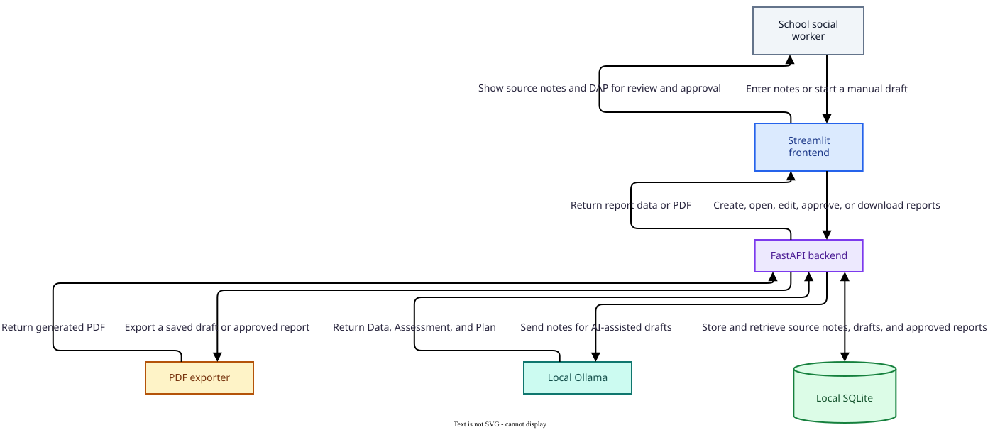

# cmsc495-social-worker-ai-assistant
AI-powered documentation assistant for school social workers, developed as a UMGC CMSC 495 capstone project.

See the [local Ollama setup guide](docs/local-llm-setup.md) for installation and model checks on Windows, macOS, and Linux.

## 🗂️ Repository Structure

```text
📁 cmsc495-social-worker-ai-assistant/
├── 📄 README.md
├── ⚙️ pyproject.toml
├── 📄 requirements.txt
├── ⚙️ .gitattributes
├── ⚙️ .gitignore
├── 📁 .assets/
│   ├── 🖼️ arch.drawio.svg
│   ├── 🖼️ backend.drawio.svg
│   └── 🖼️ frontend.drawio.svg
├── 📁 .github/
│   ├── 📁 actions/
│   │   └── 📁 setup-live-ollama/
│   │       └── ⚙️ action.yml
│   └── 📁 workflows/
│       ├── ⚙️ ci.yml
│       └── ⚙️ live-ollama.yml
├── 📁 docs/
│   ├── 📄 local-llm-setup.md
│   └── 📁 templates/
│       └── 📋 School_Social_Work_DAP_Session_Note.pdf
├── 📁 scripts/
│   ├── 🐍 ci_demo.py
│   └── 🐍 preview_pdf.py
├── 📁 src/
│   └── 📁 documentation_assistant/
│       ├── 🐍 __init__.py
│       ├── 📁 backend/
│       │   ├── 📄 README.md
│       │   ├── 🐍 __init__.py
│       │   ├── 🐍 main.py
│       │   ├── 📁 api/
│       │   │   ├── 🐍 __init__.py
│       │   │   ├── 🐍 health.py
│       │   │   └── 🐍 reports.py
│       │   ├── 📁 db/
│       │   │   ├── 🐍 __init__.py
│       │   │   ├── 🐍 connection.py
│       │   │   └── 🐍 drafts.py
│       │   ├── 📁 export/
│       │   │   ├── 🐍 __init__.py
│       │   │   ├── 🐍 pdf.py
│       │   │   └── 📁 templates/
│       │   │       └── 📋 School_Social_Work_DAP_Session_Note.pdf
│       │   ├── 📁 llm/
│       │   │   ├── 🐍 __init__.py
│       │   │   ├── 🐍 ollama.py
│       │   │   └── 📁 prompts/
│       │   │       ├── 📄 README.md
│       │   │       └── 📝 dap_generation.txt
│       │   └── 📁 schemas/
│       │       ├── 🐍 __init__.py
│       │       └── 🐍 reports.py
│       └── 📁 frontend (pending)
└── 📁 tests/
    ├── 📁 integration/
    │   ├── 🧪 test_ci_demo_cli.py
    │   ├── 🧪 test_health_api.py
    │   ├── 🧪 test_report_pdf.py
    │   └── 🧪 test_reports_api.py
    ├── 📁 llm/
    │   ├── 🧪 test_dap_quality.py
    │   └── 🧪 test_live_ollama.py
    └── 📁 unit/
        ├── 🧪 test_ci_demo.py
        ├── 🧪 test_db_connection.py
        ├── 🧪 test_drafts.py
        ├── 🧪 test_health_handler.py
        ├── 🧪 test_ollama.py
        ├── 🧪 test_pdf_renderer.py
        ├── 🧪 test_report_handlers.py
        └── 🧪 test_report_schemas.py
```

The backend creates the local SQLite file at `data/dap.db` on first use when
started from the repository root. Git ignores the `data/` folder.

## Diagram



## Continuous Integration

The [CI Pipeline](.github/workflows/ci.yml) runs on pushes, pull requests, and
manual runs. It uses Ubuntu 24.04 and Python 3.12 for the Python checks.

| Order | Job | What it checks |
| --- | --- | --- |
| 1 | Workflow Linting | actionlint checks GitHub Actions workflow syntax and expressions. |
| 2 | Workflow Formatting | Prettier checks YAML formatting under `.github/`. |
| 3 | Workflow Security | zizmor reports security findings. Scanner errors fail the job. |
| 4 | Python Linting | Ruff checks for issues such as unused imports. |
| 5 | Python Formatting | Ruff checks Python formatting. |
| 6 | Python Security | Bandit scans the backend Python code. |
| 7 | Dependency Security | pip-audit checks the dependencies in `requirements.txt` for known vulnerabilities. |
| 8 | Unit Tests | Pytest checks individual pieces, including report validation and Ollama response parsing. |
| 9 | Integration Tests | Pytest checks workflows such as saving reports in SQLite and downloading PDFs through FastAPI. |
| 10 | Coverage Report | Combines unit and integration coverage, publishes the report in the run summary, and fails below 90% backend coverage. |

Each job waits for its prerequisite jobs to pass. The regular pipeline uses
synthetic data and mocks Ollama responses where needed, so it runs without
Ollama or a GPU. View the results under **Actions → CI Pipeline**.

### Live Ollama tests

To check actual model output, go to **Actions → Live Ollama Test → Run workflow**.
The [live workflow](.github/workflows/live-ollama.yml) runs Ollama with
`qwen3:4b` on the GitHub runner. The smoke test verifies that the backend can
generate and save a draft. Select **Run the DAP quality cases after the smoke
test** to also check generated sections against synthetic notes and print
the drafts for review.

### Run Python checks locally

From the repository root, use your Python 3.12 virtual environment:

```shell
python -m pip install -r requirements.txt
python -m ruff check .
python -m ruff format --check .
python -m pytest tests/unit -v
python -m pytest tests/integration -v
```

For live model tests on your own machine, follow the
[backend test instructions](src/documentation_assistant/backend/README.md#tests).
