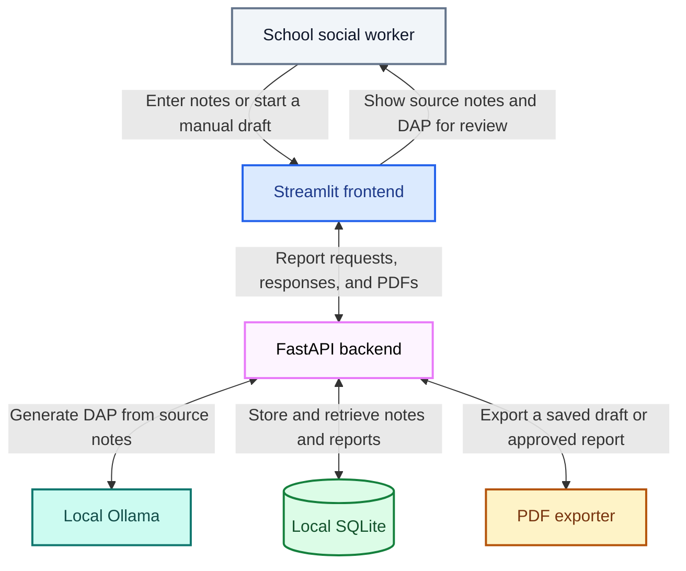
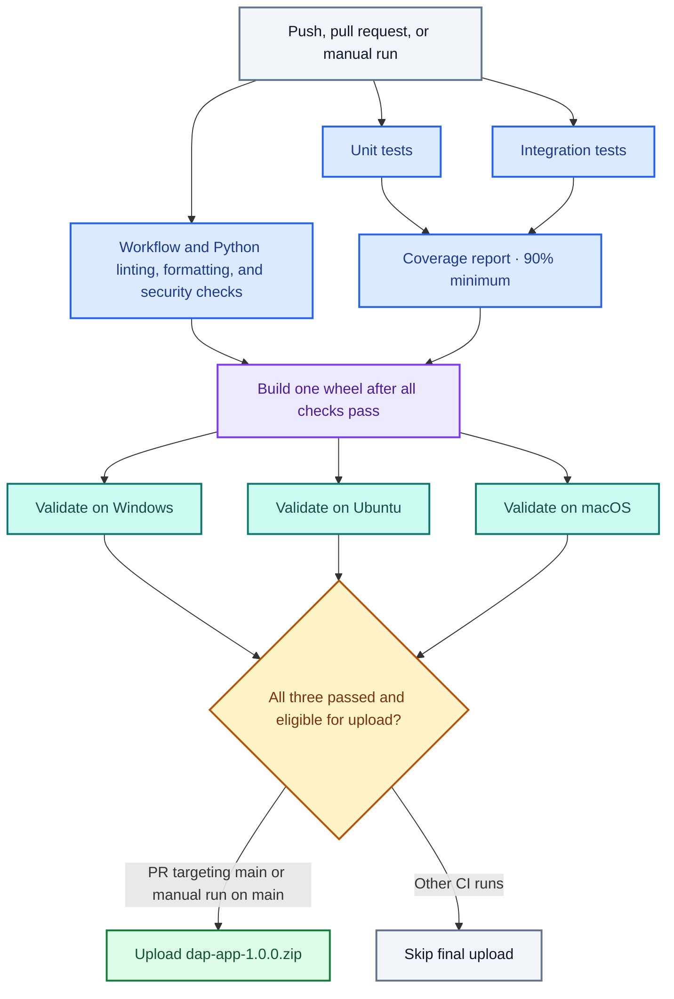
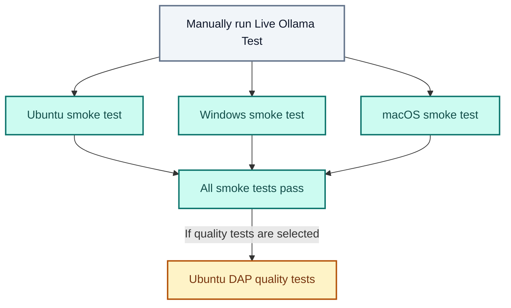

# DAP Documentation Assistant

AI-powered documentation assistant for school social workers, developed as a UMGC CMSC 495 capstone project.

## Quick Start

Install Python 3.12, then download `dap_app-1.0.0-py3-none-any.whl` from the
**Assets** section of the [GitHub release](https://github.com/OllieOzzy/cmsc495-social-worker-ai-assistant/releases).
Save the wheel in a folder you want to use for the app and open a terminal in
that folder.

### Windows PowerShell

If you need Python 3.12, install the Python Install Manager, open a new
PowerShell window, and run `py install 3.12`. [Python Install Manager guide](https://docs.python.org/3/using/windows.html#python-install-manager)

Once `py -3.12 --version` shows Python 3.12, run the commands below. If
`python --version` already shows Python 3.12, you can use
`python -m venv .venv` for the first command instead.

```powershell
py -3.12 -m venv .venv
.\.venv\Scripts\python.exe -m pip install .\dap_app-1.0.0-py3-none-any.whl
.\.venv\Scripts\dap-assistant.exe
```

### macOS and Linux

```sh
python3.12 -m venv .venv
./.venv/bin/python -m pip install ./dap_app-1.0.0-py3-none-any.whl
./.venv/bin/dap-assistant
```

Open `http://127.0.0.1:8501` in your browser. Choose **Written by hand** to get
started. For **AI-assisted draft**, start Ollama and install the default model
with `ollama pull qwen3:8b`. Follow the [local Ollama setup guide](docs/local-llm-setup.md)
for platform-specific instructions.

The app saves reports in `data/dap.db` under the folder where you launched it.
Press **Ctrl+C** in the launch terminal to stop the app.

## 🗂️ Repository Structure

```text
📁 cmsc495-social-worker-ai-assistant/
├── 📄 README.md
├── ⚙️ pyproject.toml
├── 📄 requirements.txt
├── ⚙️ .gitattributes
├── ⚙️ .gitignore
├── 📁 .github/
│   ├── 📁 actions/
│   │   └── 📁 setup-live-ollama/
│   │       └── ⚙️ action.yml
│   └── 📁 workflows/
│       ├── ⚙️ ci.yml
│       └── ⚙️ live-ollama.yml
├── 📁 docs/
│   ├── 📄 local-llm-setup.md
│   └── 📁 templates/
│       └── 📋 School_Social_Work_DAP_Session_Note.pdf
├── 📁 scripts/
│   └── 🐍 preview_pdf.py
├── 📁 src/
│   └── 📁 documentation_assistant/
│       ├── 🐍 __init__.py
│       ├── 📁 backend/
│       │   ├── 📄 README.md
│       │   ├── 🐍 __init__.py
│       │   ├── 🐍 main.py
│       │   ├── 📁 api/
│       │   │   ├── 🐍 __init__.py
│       │   │   ├── 🐍 health.py
│       │   │   └── 🐍 reports.py
│       │   ├── 📁 db/
│       │   │   ├── 🐍 __init__.py
│       │   │   ├── 🐍 connection.py
│       │   │   └── 🐍 drafts.py
│       │   ├── 📁 export/
│       │   │   ├── 🐍 __init__.py
│       │   │   ├── 🐍 pdf.py
│       │   │   └── 📁 templates/
│       │   │       └── 📋 School_Social_Work_DAP_Session_Note.pdf
│       │   ├── 📁 llm/
│       │   │   ├── 🐍 __init__.py
│       │   │   ├── 🐍 ollama.py
│       │   │   └── 📁 prompts/
│       │   │       ├── 📄 README.md
│       │   │       └── 📝 dap_generation.txt
│       │   └── 📁 schemas/
│       │       ├── 🐍 __init__.py
│       │       └── 🐍 reports.py
│       └── 📁 frontend/
│           ├── 📄 README.md
│           ├── 🐍 __init__.py
│           ├── 🐍 api_client.py
│           ├── 🐍 app.py
│           ├── 🐍 forms.py
│           ├── 🐍 reports.py
│           └── 🐍 sidebar.py
└── 📁 tests/
    ├── 📁 integration/
    │   ├── 🧪 test_health_api.py
    │   ├── 🧪 test_report_pdf.py
    │   └── 🧪 test_reports_api.py
    ├── 📁 llm/
    │   ├── 🧪 test_dap_quality.py
    │   └── 🧪 test_live_ollama.py
    └── 📁 unit/
        ├── 🧪 test_db_connection.py
        ├── 🧪 test_drafts.py
        ├── 🧪 test_health_handler.py
        ├── 🧪 test_ollama.py
        ├── 🧪 test_pdf_renderer.py
        ├── 🧪 test_report_handlers.py
        └── 🧪 test_report_schemas.py
```

The backend creates the local SQLite file at `data/dap.db` on first use when
started from the repository root. Git ignores the `data/` folder.

## Architecture



See the [frontend guide](src/documentation_assistant/frontend/README.md) and
[backend guide](src/documentation_assistant/backend/README.md) for setup and
detailed diagrams.

## Continuous Integration



The [CI Pipeline](.github/workflows/ci.yml) runs on pushes, pull requests, and
manual runs. It uses Ubuntu 24.04 and Python 3.12 for the Python checks.

| Job | What it checks |
| --- | --- |
| Workflow Linting | actionlint checks GitHub Actions workflow syntax and expressions. |
| Workflow Formatting | Prettier checks YAML formatting under `.github/`. |
| Workflow Security | zizmor reports security findings. Scanner errors fail the job. |
| Python Linting | Ruff checks for issues such as unused imports. |
| Python Formatting | Ruff checks Python formatting. |
| Python Security | Bandit scans the backend Python code. |
| Dependency Security | pip-audit checks the dependencies in `requirements.txt` for known vulnerabilities. |
| Unit Tests | Pytest checks individual pieces, including report validation and Ollama response parsing. |
| Integration Tests | Pytest checks workflows such as saving reports in SQLite and downloading PDFs through FastAPI. |
| Coverage Report | Combines unit and integration coverage, publishes the report in the run summary, and fails below 90% backend coverage. |
| Build Wheel | Builds one wheel for the validation jobs. |
| Validate Wheel | Installs the wheel on Ubuntu, Windows, and macOS with Python 3.12 and checks that the installed app can save a draft and export a PDF. |
| Upload Validated Wheel | Adds the versioned ZIP to successful pull request runs targeting `main` and manual runs on `main`. |

Linting, formatting, security checks, unit tests, and integration tests run in
parallel. Coverage waits for both test jobs. The wheel build waits for coverage
and all other checks to pass. The regular pipeline uses synthetic data and mocks
Ollama responses where needed, so it runs without Ollama or a GPU. View the
results under **Actions → CI Pipeline**.

To prepare a release, run **CI Pipeline** manually on `main`. After the wheel
checks pass, download `dap-app-<version>` from **Artifacts** and extract the
`.whl` for the GitHub Release.

### Live Ollama CI Pipeline



To check actual model output, go to **Actions → Live Ollama Test → Run workflow**.
The [live workflow](.github/workflows/live-ollama.yml) runs Ollama with
`qwen3:4b` on Ubuntu, Windows, and macOS. The smoke tests run in parallel and
verify that the backend can generate and save a draft. Each runner preloads the
model before testing and uses the app's 240-second Ollama request timeout.
Select **Run the Ubuntu DAP quality cases after all smoke tests pass** to check
generated sections against synthetic notes and print the drafts for review.

### Run Python checks locally

From the repository root, use your Python 3.12 virtual environment:

```shell
python -m pip install -r requirements.txt
python -m ruff check .
python -m ruff format --check .
python -m pytest tests/unit -v
python -m pytest tests/integration -v
```

For live model tests on your own machine, follow the
[backend test instructions](src/documentation_assistant/backend/README.md#tests).

## Upcoming release 1.1.0

- **Document scanning with OCR.** Extract text from scanned documents and review
  it before using it as session notes in the app.
- **Docker Compose setup.** Run the Streamlit frontend, FastAPI backend, and
  Ollama as separate containers on one machine.
