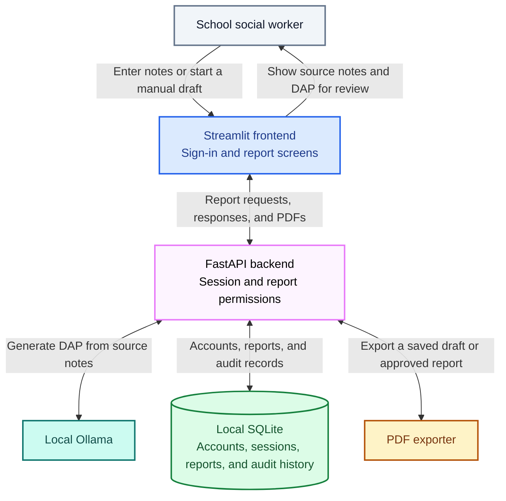
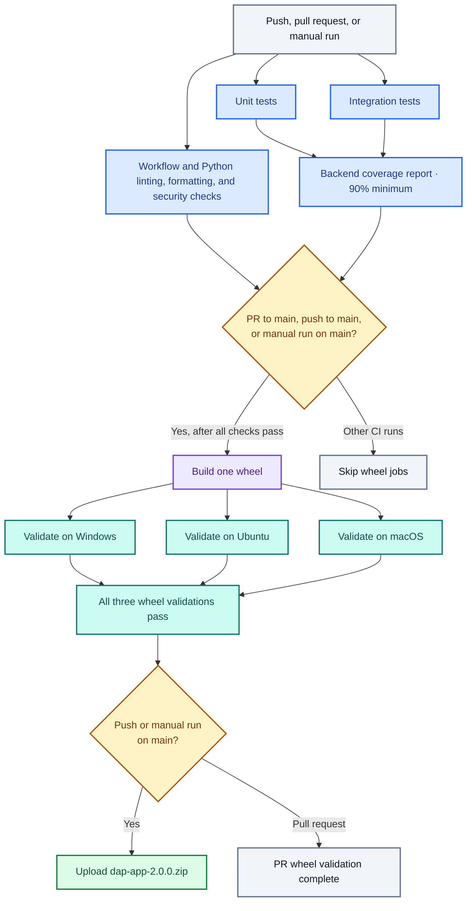
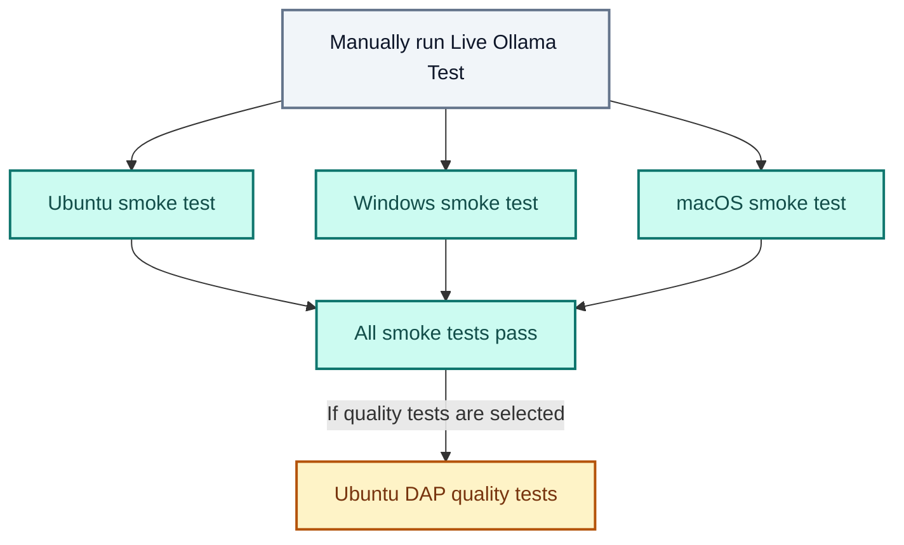

# DAP Documentation Assistant

AI-powered documentation assistant for school social workers, developed as a UMGC CMSC 495 capstone project.

### Group 6
- **Oliver Sung** — Lead Architect
- **Robert Williams** — Interface Designer
- **Mikia Robinson** — Integration Lead

## Quick Start

[Watch the earlier 1.1.0 demo](https://github.com/OllieOzzy/cmsc495-social-worker-ai-assistant/releases/download/1.1.0/demo110.mp4)

Install Python 3.12, then download `dap_app-2.0.0-py3-none-any.whl` from the
**Assets** section of the [GitHub release](https://github.com/OllieOzzy/cmsc495-social-worker-ai-assistant/releases).
Save the wheel in a folder you want to use for the app and open a terminal in that folder.

### Windows PowerShell

If you need Python 3.12, install the Python Install Manager, open a new
PowerShell window, and run `py install 3.12`. [Python Install Manager guide](https://docs.python.org/3/using/windows.html#python-install-manager)

Once `py -3.12 --version` shows Python 3.12, run the commands below. If
`python --version` already shows Python 3.12, you can use
`python -m venv .venv` for the first command instead.

```powershell
py -3.12 -m venv .venv
.\.venv\Scripts\python.exe -m pip install .\dap_app-2.0.0-py3-none-any.whl
.\.venv\Scripts\dap-assistant.exe init-demo-users
.\.venv\Scripts\dap-assistant.exe
```

### macOS and Linux

```sh
python3.12 -m venv .venv
./.venv/bin/python -m pip install ./dap_app-2.0.0-py3-none-any.whl
./.venv/bin/dap-assistant init-demo-users
./.venv/bin/dap-assistant
```

The explicit demo setup above creates `admin` and `user`, both with password
`password1234`, for synthetic-data demonstrations only. For a non-demo setup,
replace `init-demo-users` with `create-user --role admin` and follow the prompts.
See [Accounts and Permissions](#accounts-and-permissions) for roles and user management.

Open `http://127.0.0.1:8501` in your browser, sign in, and choose **Written by hand**
to get started. For **AI-assisted draft**, start Ollama and install the default model
with `ollama pull qwen3:8b`. Follow the [local Ollama setup guide](docs/LOCAL-OLLAMA-SETUP.md)
for platform-specific instructions.

The app saves reports in `data/dap.db` under the folder where you launched it.
Press **Ctrl+C** in the launch terminal to stop the app.

### Upgrade from 1.x to 2.0.0

Stop the app before upgrading. Keep a backup of `data/dap.db` while the app
is stopped, or back up the file selected by `DAP_DB_PATH` if you configured
another location. Install the new wheel using the same environment's Python
and the installation command above, then launch the app from the same working
folder so it finds the existing database. Startup adds any missing schema
columns, account/audit tables, and indexes without deleting saved reports.

**Breaking change:** all report endpoints now require authentication. Create
the initial accounts using the same working folder and `DAP_DB_PATH`, then
sign in. Existing API clients must call `POST /auth/login` and send
`Authorization: Bearer <access_token>` on report requests. Approval and
reopening require an administrator, and draft editing/deletion require ownership.

Reports created in 1.x remain unassigned and visible only to admins. Setup and
login do not automatically claim them. A trusted maintenance operation can use
`assign_report_owner` to assign an unowned report; there is no ownership-assignment
screen or public endpoint. See [Report Ownership Storage](src/documentation_assistant/backend/README.md#report-ownership-storage).

The wheel includes the frontend, backend, PDF template, and generation prompt.
Ollama and its model are installed separately and are only needed for AI-assisted
drafting. See the [Ollama guide](docs/LOCAL-OLLAMA-SETUP.md) to choose another model.

## Accounts and Permissions

Version **2.0.0** adds authentication, report ownership, role-based review,
user management, and account audit history. For a source installation, use a
Python 3.12 environment and run these commands from the repository root:

```shell
python -m pip install -e .
dap-assistant init-demo-users
dap-assistant
```

Open `http://127.0.0.1:8501` and sign in with a synthetic-data demo account:

| Username | Password | Access |
| --- | --- | --- |
| `user` | `password1234` | Own reports only; can edit and delete own unapproved drafts. |
| `admin` | `password1234` | All reports; can approve or reopen any report, and edit only own drafts. |

Demo accounts are created only by the explicit setup command, which leaves
existing credentials and roles unchanged. Use these public passwords only
with synthetic records. Use `dap-assistant create-user` to add a regular
account, or append `--role admin` for an administrator. New non-demo accounts
require passwords of 15–1,024 characters.

Administrators can also open **Manage users** in the sidebar to list accounts,
create regular or administrator accounts, and activate or deactivate users.
Deactivation revokes existing sessions and preserves the user's reports.
Reactivation requires a fresh login. Self-deactivation is blocked, and the
database protects the last active administrator from concurrent deactivation.
Keep the CLI for creating the first administrator and initial demo setup.

Use **Search accounts** to find users by part of their username or display
name. Search covers all accounts, including inactive ones, and keeps results
paginated. **Clear search** restores the full list.

For forgotten passwords, an administrator can select the account in **Manage
users**, expand **Reset password**, enter and confirm a replacement, and confirm
that all sessions will be signed out. Resetting your own admin password returns
you to login. Existing account details and reports are preserved.

Any signed-in user can select **Change password** in the sidebar to update
their own password after verifying the current one. The replacement must
contain 15–1,024 characters. Successful changes revoke all sessions and return
to login; they do not change report ownership or account permissions.

Administrators can also use **Rename account** in Manage users to edit a
username or display name. Username changes require confirmation and revoke
all sessions; display-name changes keep sessions active. Account IDs, owned
reports, and previously recorded approver names stay unchanged.

In **Change role**, administrators can promote users or demote administrators.
Confirm the permission change before saving. All affected sessions are signed
out, and the user signs in again with the new role. The last active admin
cannot be demoted, even during concurrent account changes. Inactive accounts
remain inactive; reports and approval history are preserved.

Account setup and the launcher must use the same working directory and
`DAP_DB_PATH`. Accounts, session hashes, and reports share the SQLite file.

Administrators can turn on **Show audit history** in Manage users to review
account creation, name and role changes, activation changes, and password
resets or changes. Entries show the actor, target account, UTC time, and public
before/after values. Passwords, hashes, tokens, and report content are excluded.
History uses a separate `audit_events` table in the same database and is saved
with each account change. CLI actions are labeled **Local operation**. Existing
databases gain the table at startup; earlier actions are not reconstructed.

Existing reports remain unassigned and are visible only to administrators
through authenticated routes until explicitly assigned. Approved reports
cannot be edited or deleted until an administrator reopens them.

Sign out using the sidebar. Sessions expire after eight hours; logout and
invalid sessions clear private browser-session state when detected. FastAPI enforces report
permissions independently of the interface. API clients must sign in through
`POST /auth/login` and send the returned bearer token on report requests.
The health endpoint remains public for startup checks.

See the [backend account guide](src/documentation_assistant/backend/README.md#local-account-setup)
and [frontend guide](src/documentation_assistant/frontend/README.md#accounts-and-permissions).

## 🗂️ Repository Structure

```text
📁 cmsc495-social-worker-ai-assistant/
├── 📄 README.md
├── 📄 CHANGELOG.md
├── ⚙️ pyproject.toml
├── 📄 requirements.txt
├── ⚙️ .gitattributes
├── ⚙️ .gitignore
├── 📁 .github/
│   ├── 📁 actions/
│   │   └── 📁 setup-live-ollama/
│   │       └── ⚙️ action.yml
│   └── 📁 workflows/
│       ├── ⚙️ ci.yml
│       └── ⚙️ live-ollama.yml
├── 📁 docs/
│   ├── 📄 LOCAL-OLLAMA-SETUP.md
│   └── 📁 templates/
│       └── 📋 School_Social_Work_DAP_Session_Note.pdf
├── 📁 scripts/
│   └── 🐍 preview_pdf.py
├── 📁 src/
│   └── 📁 documentation_assistant/
│       ├── 🐍 __init__.py
│       ├── 🐍 launcher.py
│       ├── 📁 backend/
│       │   ├── 📄 README.md
│       │   ├── 🐍 __init__.py
│       │   ├── 🐍 main.py
│       │   ├── 📁 api/
│       │   │   ├── 🐍 __init__.py
│       │   │   ├── 🐍 auth.py
│       │   │   ├── 🐍 health.py
│       │   │   ├── 🐍 reports.py
│       │   │   ├── 🐍 users.py
│       │   │   └── 🐍 validation.py
│       │   ├── 📁 auth/
│       │   │   ├── 🐍 __init__.py
│       │   │   ├── 🐍 cli.py
│       │   │   ├── 🐍 dependencies.py
│       │   │   ├── 🐍 passwords.py
│       │   │   └── 🐍 service.py
│       │   ├── 📁 db/
│       │   │   ├── 🐍 __init__.py
│       │   │   ├── 🐍 audit.py
│       │   │   ├── 🐍 connection.py
│       │   │   ├── 🐍 drafts.py
│       │   │   ├── 🐍 sessions.py
│       │   │   └── 🐍 users.py
│       │   ├── 📁 export/
│       │   │   ├── 🐍 __init__.py
│       │   │   ├── 🐍 pdf.py
│       │   │   └── 📁 templates/
│       │   │       └── 📋 School_Social_Work_DAP_Session_Note.pdf
│       │   ├── 📁 llm/
│       │   │   ├── 🐍 __init__.py
│       │   │   ├── 🐍 ollama.py
│       │   │   └── 📁 prompts/
│       │   │       ├── 📄 README.md
│       │   │       └── 📝 dap_generation.txt
│       │   └── 📁 schemas/
│       │       ├── 🐍 __init__.py
│       │       ├── 🐍 audit.py
│       │       ├── 🐍 auth.py
│       │       └── 🐍 reports.py
│       └── 📁 frontend/
│           ├── 📄 README.md
│           ├── 🐍 __init__.py
│           ├── 🐍 account.py
│           ├── 🐍 api_client.py
│           ├── 🐍 app.py
│           ├── 🐍 audit.py
│           ├── 🐍 auth.py
│           ├── 🐍 auth_state.py
│           ├── 🐍 forms.py
│           ├── 🐍 reports.py
│           ├── 🐍 sidebar.py
│           └── 🐍 users.py
└── 📁 tests/
    ├── 🐍 __init__.py
    ├── 🐍 auth_helpers.py
    ├── 📁 integration/
    │   ├── 🐍 conftest.py
    │   ├── 🧪 test_account_setup.py
    │   ├── 🧪 test_account_audit_api.py
    │   ├── 🧪 test_auth_api.py
    │   ├── 🧪 test_auth_indexes.py
    │   ├── 🧪 test_ai_session_revocation.py
    │   ├── 🧪 test_frontend_auth.py
    │   ├── 🧪 test_frontend_session_heartbeat.py
    │   ├── 🧪 test_frontend_audit.py
    │   ├── 🧪 test_frontend_password_change.py
    │   ├── 🧪 test_frontend_user_management.py
    │   ├── 🧪 test_frontend_user_rename.py
    │   ├── 🧪 test_frontend_user_roles.py
    │   ├── 🧪 test_frontend_recovery.py
    │   ├── 🧪 test_frontend_reports.py
    │   ├── 🧪 test_health_api.py
    │   ├── 🧪 test_report_pdf.py
    │   ├── 🧪 test_password_reset_api.py
    │   ├── 🧪 test_password_change_api.py
    │   ├── 🧪 test_report_ownership.py
    │   ├── 🧪 test_report_permissions.py
    │   ├── 🧪 test_reports_api.py
    │   ├── 🧪 test_user_management_api.py
    │   ├── 🧪 test_user_profile_api.py
    │   ├── 🧪 test_user_role_api.py
    │   ├── 🧪 test_user_search_api.py
    │   └── 🧪 test_users_db.py
    ├── 📁 llm/
    │   ├── 🧪 test_dap_quality.py
    │   └── 🧪 test_live_ollama.py
    ├── 📁 packaging/
    │   └── 🐍 check_installed_wheel.py
    └── 📁 unit/
        ├── 🧪 test_audit.py
        ├── 🧪 test_auth_service.py
        ├── 🧪 test_db_connection.py
        ├── 🧪 test_drafts.py
        ├── 🧪 test_frontend_api_client.py
        ├── 🧪 test_frontend_account.py
        ├── 🧪 test_frontend_app.py
        ├── 🧪 test_frontend_audit.py
        ├── 🧪 test_frontend_auth.py
        ├── 🧪 test_frontend_forms.py
        ├── 🧪 test_frontend_reports.py
        ├── 🧪 test_frontend_sidebar.py
        ├── 🧪 test_frontend_users.py
        ├── 🧪 test_health_handler.py
        ├── 🧪 test_launcher.py
        ├── 🧪 test_ollama.py
        ├── 🧪 test_passwords.py
        ├── 🧪 test_pdf_renderer.py
        ├── 🧪 test_report_handlers.py
        ├── 🧪 test_report_schemas.py
        ├── 🧪 test_sessions.py
        ├── 🧪 test_user_schemas.py
        └── 🧪 test_users.py
```

The backend creates or upgrades the local SQLite database during startup.
Its default path is `data/dap.db` relative to the folder where the backend or
launcher runs. Set `DAP_DB_PATH` to choose another file. Git ignores the
repository's `data/` folder.

## Architecture



See the [frontend guide](src/documentation_assistant/frontend/README.md) and
[backend guide](src/documentation_assistant/backend/README.md) for setup and
detailed diagrams.

## Continuous Integration



The [CI Pipeline](.github/workflows/ci.yml) runs on pushes, pull requests, and
manual runs. It uses Ubuntu 24.04 and Python 3.12 for the Python checks.

| Job | What it checks |
| --- | --- |
| Workflow Linting | actionlint checks GitHub Actions workflow syntax and expressions. |
| Workflow Formatting | Prettier checks YAML formatting under `.github/`. |
| Workflow Security | zizmor reports security findings. Scanner errors fail the job. |
| Python Linting | Ruff checks for issues such as unused imports. |
| Python Formatting | Ruff checks Python formatting. |
| Python Security | Bandit scans the backend Python code. |
| Dependency Security | pip-audit checks the dependencies in `requirements.txt` for known vulnerabilities. |
| Unit Tests | Pytest checks backend validation, Ollama response parsing, and frontend API handling, forms, routing, and actions. |
| Integration Tests | Pytest checks FastAPI and SQLite workflows, Streamlit report actions, recovery, proxy handling, pagination, and PDF downloads. |
| Coverage Report | Combines unit and integration coverage, publishes the report in the run summary, and fails below 90% backend coverage. |
| Build Wheel | Builds one wheel after checks pass on PRs targeting `main`, pushes to `main`, and manual runs on `main`. |
| Validate Wheel | Installs the wheel on Ubuntu, Windows, and macOS with Python 3.12 and checks that the installed app can save a draft and export a PDF. |
| Upload Validated Wheel | Adds the versioned ZIP after all three validations pass, only on pushes or manual runs on `main`. |

Linting, formatting, security checks, unit tests, and integration tests run in
parallel. Coverage waits for both test jobs. The wheel build waits for coverage
and all other checks to pass. Wheel building and validation run on pull requests
targeting `main`, pushes to `main` (including PR merges), and manual runs on
`main`. Ordinary branch pushes and PRs targeting other branches skip those jobs.
The final versioned artifact upload runs only on pushes and manual runs on
`main`; PR runs upload a candidate wheel only for cross-platform validation.
The regular pipeline uses synthetic data and mocks
Ollama responses where needed, so it runs without Ollama or a GPU. View the
results under **Actions → CI Pipeline**.

To prepare a release, run **CI Pipeline** manually on `main`. After the wheel
checks pass, download `dap-app-<version>` from **Artifacts** and extract the
`.whl` for the GitHub Release.

Before publishing `2.0.0`, verify the final commit on `main` with both workflows.
Enable the optional DAP quality cases in **Live Ollama Test**. CI uses
`qwen3:4b`, while the app defaults to `qwen3:8b`; also review representative
drafts locally with the model you intend to demonstrate.

Install the validated wheel in a separate environment and walk through
creation, saving, reopening, editing, approval, and PDF export. Check backend
and Ollama outage recovery, and verify that unsaved browser form edits survive
status-panel checks and automatic refreshes. Also verify both roles, account
management, session revocation, and audit history. Tag the verified commit `2.0.0`
and attach its validated wheel to the GitHub Release. The workflows upload
artifacts; they do not create a release or publish to a package registry.

### Live Ollama CI Pipeline



To check actual model output, go to **Actions → Live Ollama Test → Run workflow**.
The [live workflow](.github/workflows/live-ollama.yml) is started manually and
runs Ollama with `qwen3:4b`. It has two kinds of tests: smoke tests for basic
compatibility and optional quality tests for generated report content.

#### Smoke tests on Ubuntu, Windows, and macOS

The workflow starts three independent jobs in parallel, one for each operating
system. Each job uses the [shared setup action](.github/actions/setup-live-ollama/action.yml)
to install Python dependencies, restore cached Ollama and model files when
available, and download missing files. New Ollama downloads are checked against
a SHA-256 checksum. The action starts a real Ollama server on the runner and
preloads the model before running the test.

The [smoke test](tests/llm/test_live_ollama.py) then checks the following workflow:

1. Create a temporary SQLite database and a FastAPI app instance using the real
   backend code. FastAPI's test client calls the app inside the test process;
   no separate backend web server is needed.
2. Send synthetic session notes to `/reports/generate`. The backend calls the
   real Ollama server using the app's 240-second request timeout.
3. Check that the request succeeds and returns an unapproved draft with nonempty
   Data, Assessment, and Plan sections. For these notes, the Plan must say
   `Not documented.` because no follow-up plan was provided.
4. Create a new app instance using the same temporary database and retrieve the
   report by its ID. Check that the notes and generated sections were saved
   correctly, the status is still `draft`, and no approval timestamp is set.

Running this same test on all three systems helps catch differences in setup,
paths, startup commands, and backend integration. It verifies more than whether
Ollama starts: the app must generate, save, and retrieve a draft successfully.
Each job has its own temporary environment and database; it does not use your
local reports or deploy a permanent service. The test does not exercise the
Streamlit interface or fully evaluate report quality.

#### Optional DAP quality tests

Select **Run the Ubuntu DAP quality cases after all smoke tests pass** when
starting the workflow to check generated sections against synthetic notes and
print the drafts for review. This separate job runs only on Ubuntu, after all
three smoke tests pass, and uses the same setup action to prepare Ollama. Its
purpose is to examine report content in more detail, while the smoke tests
check the basic backend workflow across the supported operating systems.

### Run Python checks locally

From the repository root, use your Python 3.12 virtual environment:

```shell
python -m pip install -r requirements.txt
python -m ruff check .
python -m ruff format --check .
python -m pytest tests/unit -v
python -m pytest tests/integration -v
```

For live model tests on your own machine, follow the
[backend test instructions](src/documentation_assistant/backend/README.md#tests).

## References

Official repositories and documentation for the tools used in this project:

- [Ollama](https://github.com/ollama/ollama) — Running local language models for DAP draft generation.
- [Streamlit documentation](https://docs.streamlit.io/) — Building the frontend, forms, and report review screens.
- [FastAPI documentation](https://fastapi.tiangolo.com/) — Creating backend API endpoints and handling requests.
- [SQLite documentation](https://www.sqlite.org/docs.html) — Storing and retrieving reports locally.
- [Pydantic documentation](https://docs.pydantic.dev/latest/) — Defining data models and validating report inputs.
- [HTTPX documentation](https://www.python-httpx.org/) — Sending HTTP requests between application components.
- [ReportLab documentation](https://docs.reportlab.com/) — Generating PDF report content.
- [pypdf documentation](https://pypdf.readthedocs.io/en/stable/) — Working with PDF files and templates.
- [pytest documentation](https://docs.pytest.org/en/stable/) — Writing and running automated tests.
- [GitHub Actions documentation](https://docs.github.com/en/actions) — Configuring CI workflows and automated checks.
- [Ruff documentation](https://docs.astral.sh/ruff/) — Checking Python code quality and formatting.

## Release 2.0.0

Version 2.0.0 introduces authenticated, account-based access. See the
[changelog](CHANGELOG.md) for the changes since `1.1.0` and the upgrade notes above.

- **Accounts and sessions.** Argon2id passwords, revocable eight-hour sessions,
  login throttling, and explicit local account setup.
- **Report permissions.** Users see their own reports; admins can review all
  reports and approve or reopen them. Owners control draft editing and deletion.
- **User management.** Admin account creation, search, activation, renaming,
  role changes, and password reset, plus self-service password changes.
- **Account audit history.** Transactional records of account actions, excluding
  credentials and report content, with an admin-only history view.
- **Authentication optimizations.** One-query session verification, indexes
  for revocation and cleanup, and indexed account-filtered audit reads.

## Future Improvements

- **Document scanning with OCR.** Extract text from scanned documents and review
  it before using it as session notes in the app.
- **Containerization with Docker Compose.** Run the Streamlit frontend,
  FastAPI backend, and Ollama as separate containers on one machine.
