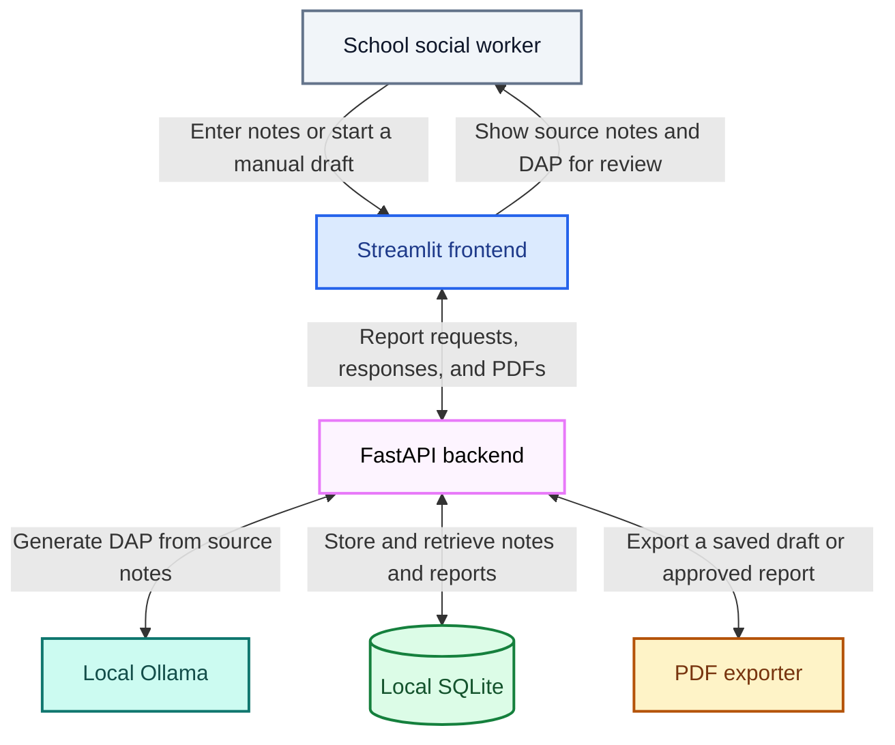
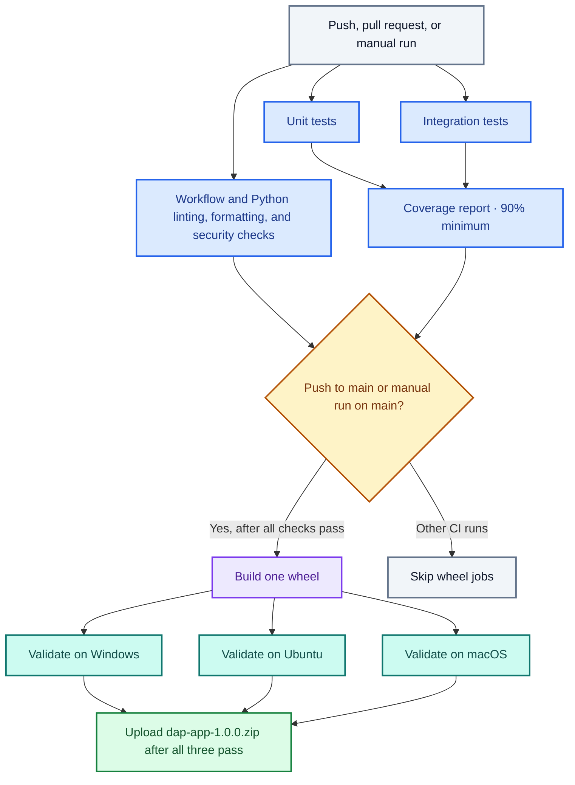
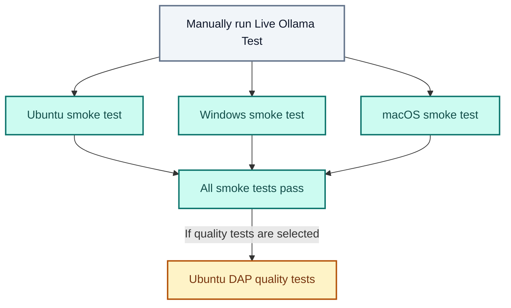

# DAP Documentation Assistant

AI-powered documentation assistant for school social workers, developed as a UMGC CMSC 495 capstone project.

### Group 6
- **Oliver Sung** — Lead Architect
- **Robert Williams** — Interface Designer
- **Mikia Robinson** — Integration Lead

## Quick Start

[Download and Watch the Demo](https://github.com/OllieOzzy/cmsc495-social-worker-ai-assistant/releases/download/1.0.0/demo.mp4)

Install Python 3.12, then download `dap_app-1.0.0-py3-none-any.whl` from the
**Assets** section of the [GitHub release](https://github.com/OllieOzzy/cmsc495-social-worker-ai-assistant/releases).
Save the wheel in a folder you want to use for the app and open a terminal in
that folder.

### Windows PowerShell

If you need Python 3.12, install the Python Install Manager, open a new
PowerShell window, and run `py install 3.12`. [Python Install Manager guide](https://docs.python.org/3/using/windows.html#python-install-manager)

Once `py -3.12 --version` shows Python 3.12, run the commands below. If
`python --version` already shows Python 3.12, you can use
`python -m venv .venv` for the first command instead.

```powershell
py -3.12 -m venv .venv
.\.venv\Scripts\python.exe -m pip install .\dap_app-1.0.0-py3-none-any.whl
.\.venv\Scripts\dap-assistant.exe
```

### macOS and Linux

```sh
python3.12 -m venv .venv
./.venv/bin/python -m pip install ./dap_app-1.0.0-py3-none-any.whl
./.venv/bin/dap-assistant
```

Open `http://127.0.0.1:8501` in your browser. Choose **Written by hand** to get
started. For **AI-assisted draft**, start Ollama and install the default model
with `ollama pull qwen3:8b`. Follow the [local Ollama setup guide](docs/local-llm-setup.md)
for platform-specific instructions.

The app saves reports in `data/dap.db` under the folder where you launched it.
Press **Ctrl+C** in the launch terminal to stop the app.

## 🗂️ Repository Structure

```text
📁 cmsc495-social-worker-ai-assistant/
├── 📄 README.md
├── ⚙️ pyproject.toml
├── 📄 requirements.txt
├── ⚙️ .gitattributes
├── ⚙️ .gitignore
├── 📁 .github/
│   ├── 📁 actions/
│   │   └── 📁 setup-live-ollama/
│   │       └── ⚙️ action.yml
│   └── 📁 workflows/
│       ├── ⚙️ ci.yml
│       └── ⚙️ live-ollama.yml
├── 📁 docs/
│   ├── 📄 local-llm-setup.md
│   └── 📁 templates/
│       └── 📋 School_Social_Work_DAP_Session_Note.pdf
├── 📁 scripts/
│   └── 🐍 preview_pdf.py
├── 📁 src/
│   └── 📁 documentation_assistant/
│       ├── 🐍 __init__.py
│       ├── 📁 backend/
│       │   ├── 📄 README.md
│       │   ├── 🐍 __init__.py
│       │   ├── 🐍 main.py
│       │   ├── 📁 api/
│       │   │   ├── 🐍 __init__.py
│       │   │   ├── 🐍 health.py
│       │   │   └── 🐍 reports.py
│       │   ├── 📁 db/
│       │   │   ├── 🐍 __init__.py
│       │   │   ├── 🐍 connection.py
│       │   │   └── 🐍 drafts.py
│       │   ├── 📁 export/
│       │   │   ├── 🐍 __init__.py
│       │   │   ├── 🐍 pdf.py
│       │   │   └── 📁 templates/
│       │   │       └── 📋 School_Social_Work_DAP_Session_Note.pdf
│       │   ├── 📁 llm/
│       │   │   ├── 🐍 __init__.py
│       │   │   ├── 🐍 ollama.py
│       │   │   └── 📁 prompts/
│       │   │       ├── 📄 README.md
│       │   │       └── 📝 dap_generation.txt
│       │   └── 📁 schemas/
│       │       ├── 🐍 __init__.py
│       │       └── 🐍 reports.py
│       └── 📁 frontend/
│           ├── 📄 README.md
│           ├── 🐍 __init__.py
│           ├── 🐍 api_client.py
│           ├── 🐍 app.py
│           ├── 🐍 forms.py
│           ├── 🐍 reports.py
│           └── 🐍 sidebar.py
└── 📁 tests/
    ├── 📁 integration/
    │   ├── 🧪 test_health_api.py
    │   ├── 🧪 test_report_pdf.py
    │   └── 🧪 test_reports_api.py
    ├── 📁 llm/
    │   ├── 🧪 test_dap_quality.py
    │   └── 🧪 test_live_ollama.py
    └── 📁 unit/
        ├── 🧪 test_db_connection.py
        ├── 🧪 test_drafts.py
        ├── 🧪 test_health_handler.py
        ├── 🧪 test_ollama.py
        ├── 🧪 test_pdf_renderer.py
        ├── 🧪 test_report_handlers.py
        └── 🧪 test_report_schemas.py
```

The backend creates the local SQLite file at `data/dap.db` on first use when
started from the repository root. Git ignores the `data/` folder.

## Architecture



See the [frontend guide](src/documentation_assistant/frontend/README.md) and
[backend guide](src/documentation_assistant/backend/README.md) for setup and
detailed diagrams.

## Continuous Integration



The [CI Pipeline](.github/workflows/ci.yml) runs on pushes, pull requests, and
manual runs. It uses Ubuntu 24.04 and Python 3.12 for the Python checks.

| Job | What it checks |
| --- | --- |
| Workflow Linting | actionlint checks GitHub Actions workflow syntax and expressions. |
| Workflow Formatting | Prettier checks YAML formatting under `.github/`. |
| Workflow Security | zizmor reports security findings. Scanner errors fail the job. |
| Python Linting | Ruff checks for issues such as unused imports. |
| Python Formatting | Ruff checks Python formatting. |
| Python Security | Bandit scans the backend Python code. |
| Dependency Security | pip-audit checks the dependencies in `requirements.txt` for known vulnerabilities. |
| Unit Tests | Pytest checks individual pieces, including report validation and Ollama response parsing. |
| Integration Tests | Pytest checks workflows such as saving reports in SQLite and downloading PDFs through FastAPI. |
| Coverage Report | Combines unit and integration coverage, publishes the report in the run summary, and fails below 90% backend coverage. |
| Build Wheel | Builds one wheel after checks pass on pushes to `main` and manual runs on `main`. |
| Validate Wheel | Installs the wheel on Ubuntu, Windows, and macOS with Python 3.12 and checks that the installed app can save a draft and export a PDF. |
| Upload Validated Wheel | Adds the versioned ZIP after all three wheel validation jobs pass. |

Linting, formatting, security checks, unit tests, and integration tests run in
parallel. Coverage waits for both test jobs. The wheel build waits for coverage
and all other checks to pass. Wheel building, validation, and the final upload run
on pushes to `main`, including PR merges, and manual runs on `main`. Branch and
pull request runs skip those wheel jobs. The regular pipeline uses synthetic data and mocks
Ollama responses where needed, so it runs without Ollama or a GPU. View the
results under **Actions → CI Pipeline**.

To prepare a release, run **CI Pipeline** manually on `main`. After the wheel
checks pass, download `dap-app-<version>` from **Artifacts** and extract the
`.whl` for the GitHub Release.

### Live Ollama CI Pipeline



To check actual model output, go to **Actions → Live Ollama Test → Run workflow**.
The [live workflow](.github/workflows/live-ollama.yml) is started manually and
runs Ollama with `qwen3:4b`. It has two kinds of tests: smoke tests for basic
compatibility and optional quality tests for generated report content.

#### Smoke tests on Ubuntu, Windows, and macOS

The workflow starts three independent jobs in parallel, one for each operating
system. Each job uses the [shared setup action](.github/actions/setup-live-ollama/action.yml)
to install Python dependencies, restore cached Ollama and model files when
available, and download missing files. New Ollama downloads are checked against
a SHA-256 checksum. The action starts a real Ollama server on the runner and
preloads the model before running the test.

The [smoke test](tests/llm/test_live_ollama.py) then checks the following workflow:

1. Create a temporary SQLite database and a FastAPI app instance using the real
   backend code. FastAPI's test client calls the app inside the test process;
   no separate backend web server is needed.
2. Send synthetic session notes to `/reports/generate`. The backend calls the
   real Ollama server using the app's 240-second request timeout.
3. Check that the request succeeds and returns an unapproved draft with nonempty
   Data, Assessment, and Plan sections. For these notes, the Plan must say
   `Not documented.` because no follow-up plan was provided.
4. Create a new app instance using the same temporary database and retrieve the
   report by its ID. Check that the notes and generated sections were saved
   correctly, the status is still `draft`, and no approval timestamp is set.

Running this same test on all three systems helps catch differences in setup,
paths, startup commands, and backend integration. It verifies more than whether
Ollama starts: the app must generate, save, and retrieve a draft successfully.
Each job has its own temporary environment and database; it does not use your
local reports or deploy a permanent service. The test does not exercise the
Streamlit interface or fully evaluate report quality.

#### Optional DAP quality tests

Select **Run the Ubuntu DAP quality cases after all smoke tests pass** when
starting the workflow to check generated sections against synthetic notes and
print the drafts for review. This separate job runs only on Ubuntu, after all
three smoke tests pass, and uses the same setup action to prepare Ollama. Its
purpose is to examine report content in more detail, while the smoke tests
check the basic backend workflow across the supported operating systems.

### Run Python checks locally

From the repository root, use your Python 3.12 virtual environment:

```shell
python -m pip install -r requirements.txt
python -m ruff check .
python -m ruff format --check .
python -m pytest tests/unit -v
python -m pytest tests/integration -v
```

For live model tests on your own machine, follow the
[backend test instructions](src/documentation_assistant/backend/README.md#tests).

## References

Official repositories and documentation for the tools used in this project:

- [Ollama](https://github.com/ollama/ollama) — Running local language models for DAP draft generation.
- [Streamlit documentation](https://docs.streamlit.io/) — Building the frontend, forms, and report review screens.
- [FastAPI documentation](https://fastapi.tiangolo.com/) — Creating backend API endpoints and handling requests.
- [SQLite documentation](https://www.sqlite.org/docs.html) — Storing and retrieving reports locally.
- [Pydantic documentation](https://docs.pydantic.dev/latest/) — Defining data models and validating report inputs.
- [HTTPX documentation](https://www.python-httpx.org/) — Sending HTTP requests between application components.
- [ReportLab documentation](https://docs.reportlab.com/) — Generating PDF report content.
- [pypdf documentation](https://pypdf.readthedocs.io/en/stable/) — Working with PDF files and templates.
- [pytest documentation](https://docs.pytest.org/en/stable/) — Writing and running automated tests.
- [GitHub Actions documentation](https://docs.github.com/en/actions) — Configuring CI workflows and automated checks.
- [Ruff documentation](https://docs.astral.sh/ruff/) — Checking Python code quality and formatting.

## Upcoming release 1.1.0

- **Automated frontend tests.** Test Streamlit form validation, report review
  actions, and error messages when backend requests fail.
- **Document scanning with OCR.** Extract text from scanned documents and review
  it before using it as session notes in the app.
- **Docker Compose setup.** Run the Streamlit frontend, FastAPI backend, and
  Ollama as separate containers on one machine.
