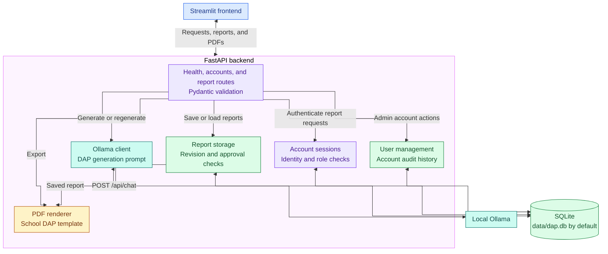
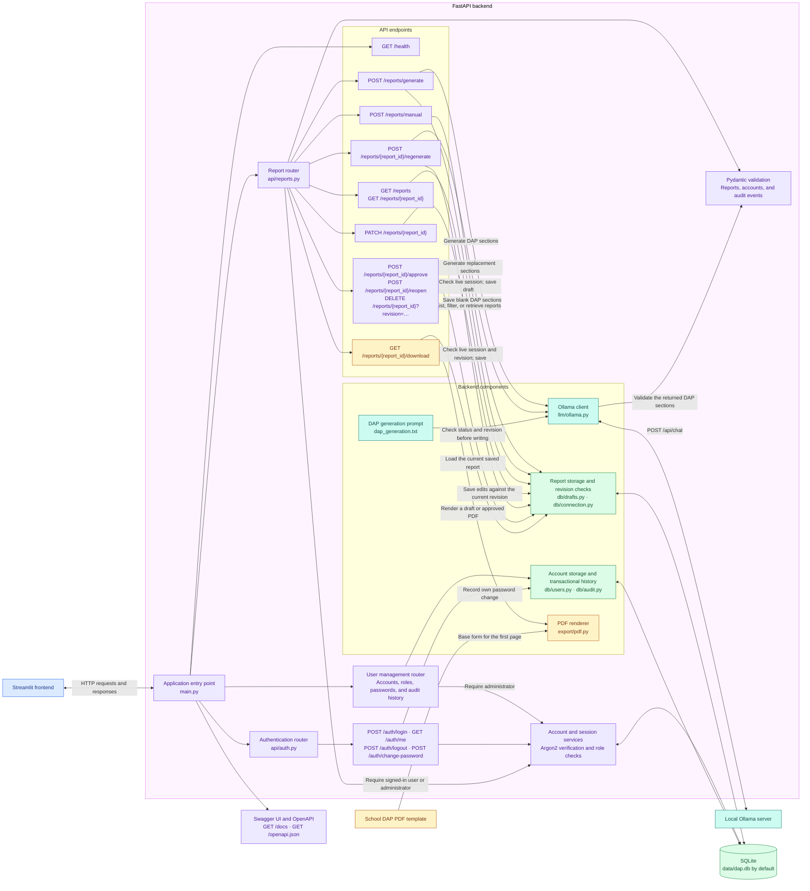

# FastAPI Backend

The 2.0.0 FastAPI backend supports manual and AI-assisted DAP drafts, searchable
report history, review and approval, and PDF downloads. It saves source notes
and reports in SQLite and uses local Ollama for AI generation. Use synthetic
student data for development and testing.

## Overview Diagram



## Detailed Diagram



## Local Setup

Run all commands in this guide from the **repository root**, which contains
`requirements.txt` and `pyproject.toml`.

Use Python 3.12. If you already have a working `.venv` for this project,
skip the creation command and use the environment you have.

**Windows (PowerShell)**

Use the creation command that matches your setup:

- If `python --version` shows Python 3.12, run `python -m venv .venv`.
- If `py -3.12 --version` shows Python 3.12, run `py -3.12 -m venv .venv`.
- If you still need Python 3.12, install the Python Install Manager, open a
  new PowerShell window, and run `py install 3.12`. Then run
  `py -3.12 -m venv .venv`. [Python Install Manager guide](https://docs.python.org/3/using/windows.html#python-install-manager)

Activate the environment with `.\.venv\Scripts\Activate.ps1`. If that
script is missing or PowerShell blocks it, use `.\.venv\Scripts\python.exe`
in place of `python` in the commands below.

**macOS and Linux (bash or zsh)**

```bash
python3.12 -m venv .venv
source .venv/bin/activate
```

Install the dependencies using the virtual environment's Python:

```bash
python -m pip install -r requirements.txt
```

## Local Account Setup

Version 2.0.0 includes account setup, backend login, report ownership, and
administrator-only review. All report endpoints require a
valid bearer session. Sign in through Streamlit, or use `/docs` and its
**Authorize** button to test the backend directly.

Install the project in editable mode to make the `dap-assistant` command
available in your active virtual environment:

```bash
python -m pip install -e .
```

For synthetic-data demonstrations, explicitly create the two demo accounts:

```bash
dap-assistant init-demo-users
```

| Username | Password | Role |
| --- | --- | --- |
| `admin` | `password1234` | Administrator |
| `user` | `password1234` | Regular user |

Passwords are stored as salted Argon2id hashes. Demo accounts are not created
automatically, and rerunning this command does not reset existing passwords
or change existing roles. Use these public credentials only with synthetic data.

To add another account, run:

```bash
dap-assistant create-user
```

The command prompts for a username, display name, password, and password
confirmation. Password entry is hidden. New accounts default to the `user`
role; use `dap-assistant create-user --role admin` to create an administrator.
You can also supply `--username` and `--display-name`. Passwords are entered
interactively rather than passed as command arguments and must contain
15–1,024 characters. The explicit demo setup uses its shorter public password.

Both commands use the same SQLite database as FastAPI: `data/dap.db` relative
to the working directory, or the location set by `DAP_DB_PATH`. Run setup and
the backend with the same working directory and database setting. Running
`dap-assistant` without a subcommand still starts the backend and frontend.

### Backend Login and Sessions

After creating an account and starting FastAPI, open `/docs` and execute
`POST /auth/login` with the account's credentials:

```json
{"username": "user", "password": "password1234"}
```

Copy the returned `access_token`, click **Authorize** in Swagger UI, and paste
the token into the bearer-token field. Execute `GET /auth/me` to see the
signed-in account. Execute `POST /auth/logout` to revoke that session; using
the same token afterward returns `401`. Signing out leaves other sessions
for the account active.

Sessions expire eight hours after login, including across backend restarts.
Using a session does not extend its lifetime. SQLite stores only token hashes;
keep the returned token private. The backend checks account activity and the
current role on authenticated requests.

Session verification joins the session and account in one query using one
connection. It selects only public identity fields, checks expiry and activation,
and reads the current role on every request. No password hash is needed for
session verification, and permissions are not cached between requests.

AI generation and regeneration also validate the initiating token, account
activity, expiry, and owner inside the report write transaction after inference.
The write lock prevents account or session revocation from committing between
that validation and the report write. Invalid sessions return `401` without
creating a draft or changing the existing report, including its revision.

SQLite indexes on `user_sessions.user_id`, `user_sessions.expires_at`, and
`login_attempts.window_started_at` support session revocation and expired-record
cleanup as these tables grow. Startup creates missing indexes automatically
for existing databases. Token and username lookups continue to use their
existing primary-key indexes; session expiry and login limits are unchanged.

Five unsuccessful attempts for the same normalized username within five
minutes cause further attempts to return `429` with a `Retry-After` header.
The counter persists across backend restarts and resets after a successful
login or when the five-minute window expires. Unknown usernames receive the
same credential error and attempt limit. This is a local-app safeguard, not
a replacement for deployment-level rate limiting on a public server.

### Report Ownership Storage

Saved reports and history summaries include `owner_id`, which identifies the
owning account. Storage functions can create reports for an account and scope
reads to an authenticated viewer: regular users see their own reports, while
administrators see all reports. Ownership filtering happens before search
pagination. The API supplies the signed-in identity when creating, listing,
retrieving, editing, regenerating, deleting, or downloading reports.

Existing reports retain `owner_id: null` during database upgrades. Scoped
regular-user queries cannot see them; administrator queries can. Startup and
login never assign them automatically. The internal `assign_report_owner`
maintenance function can explicitly assign an unowned report to an existing
account without changing its content or revision. It cannot transfer a report
that already has an owner. Ownership is not accepted in report request bodies.

### Report Permissions

| Action | Regular user | Administrator |
| --- | --- | --- |
| Create a report | Own account | Own account |
| Read history, open reports, or download PDFs | Own reports | All reports |
| Edit, regenerate, or delete an unapproved draft | Own reports | Own reports |
| Approve or reopen a report | Not allowed | Any report |
| Edit or delete an approved report | Not allowed | Not allowed |

An administrator must reopen an approved report before its owner can correct
or delete it. Approval records the authenticated administrator's display name,
account ID, and a UTC timestamp. A supplied legacy `approved_by` field is
ignored; it cannot impersonate another reviewer. Reopening clears the approval
details and preserves report ownership.

Missing or expired sessions return `401`. Regular users receive `404` for
another user's report, including its PDF, without exposing whether it exists.
Administrator-only actions return `403` for regular users. Administrators also
receive `403` if they attempt to edit or delete content owned by someone else.

## Change Your Own Password

Any signed-in account can call `POST /auth/change-password` with
`current_password` and `new_password`. The account is taken from the bearer
session; a target username or user ID is not accepted. New passwords follow
the 15–1,024-character policy. Current-password verification also supports the
shorter existing demo credentials.

A successful change returns `204`, replaces the salted hash, and revokes
every session, including the current one. Identity, role, activation, report
ownership, and saved reports remain unchanged. Sign in again with the new
password. An incorrect current password returns `403` without revoking the
session. Incorrect guesses share the five-attempt, five-minute login window;
exceeding it returns `429` with `Retry-After`.

Storage checks the verified hash and activation again under the write lock.
An intervening password reset or deactivation returns `409` rather than being
overwritten. Invalid replacements return `422`; missing or expired sessions
return `401`. Validation responses never echo either password.

## User Management

Administrators can use Streamlit's **Manage users** screen or these endpoints:

- `GET /users?limit=25&offset=0` lists public account fields, including inactive
  accounts, alphabetically by username. Pages allow 1–100 accounts.
  Optional `search` (at most 200 characters) matches part of a username or
  display name, ignoring case, before pagination. Surrounding whitespace is
  ignored; an empty search lists all accounts. `%` and `_` are literal text.
  For example, `GET /users?search=taylor&limit=25&offset=0` finds matching users
  across the directory. Search remains administrator-only and returns no hashes.
- `POST /users` creates an account with `username`, `display_name`, `password`,
  and optional `role` (`user` by default, or `admin`). It uses the same
  normalization, Argon2id hashing, and 15–1,024-character password policy as
  the CLI. Duplicate usernames return `409` without replacing credentials.
- `PATCH /users/{user_id}` accepts `{"is_active": false}` to deactivate, or
  `{"is_active": true}` to reactivate. It does not accept role or password
  changes. A missing account returns `404`.

### Account Audit History

`GET /users/audit-events?limit=25&offset=0` returns committed account actions,
newest first by event ID. It requires an administrator and uses
`Cache-Control: no-store`. Pages allow 1–100 entries; optional `target_id`
filters by a stable account UUID before pagination. No edit or delete operation
is exposed for history.

Target-filtered reads use a direct equality predicate and the existing
`audit_events_target_id` index for filtering and newest-first ordering.
Unfiltered reads use a separate query ordered by event ID. No additional
index or database migration is required for this query optimization.

The separate `audit_events` table in `dap.db` records account creation,
renaming, activation/deactivation, role changes, password resets, and
self-service password changes. Each entry includes a UTC timestamp, stable
actor and target IDs, username snapshots, and public before/after values.
Only username, display name, role, and activation can appear in `changes`.
Password actions have empty changes; no passwords, hashes, session tokens,
source notes, or DAP text are recorded.

The authenticated actor ID comes from the backend dependency, never the request
body. CLI and trusted local storage operations have no signed-in actor and
are labeled local operations. Account changes, session revocation, and audit
insertion commit together: an audit failure rolls back the account mutation.
Rejected changes and no-op name, role, or activation updates add no event.

Startup adds the table to existing databases and preserves existing records;
it does not reconstruct earlier actions. History is read-only through the app,
but it is not tamper-proof against someone who can edit the SQLite file.

### Password Recovery and Account Changes

`POST /users/{user_id}/reset-password` accepts a replacement `password` of
15–1,024 characters. It replaces the Argon2id hash, revokes every session, and
clears the account's failed-login window in one transaction. Role, activation,
identity, reports, and approval records are preserved. Inactive accounts stay
inactive. Resetting your own admin password requires a fresh login too.

Invalid passwords return `422` without changing credentials or sessions; a
missing target returns `404`. Session creation rechecks the verified hash
and activation under the write lock, so a login started before a reset or
deactivation cannot issue a usable token afterward.

All user-management endpoints require administrator access. Account responses exclude
password hashes and use `Cache-Control: no-store`. Validation responses do
not echo submitted passwords. Deactivation deletes every session for that
account while preserving its reports and recorded approvals. Reactivation
requires a new login; old tokens remain invalid.

An administrator cannot deactivate their own account (`409`). The storage
transaction also prevents deactivating the last active administrator, even
when requests run concurrently. Keep `create-user --role admin` for initial
setup; GUI management requires an administrator to already be signed in.

`PATCH /users/{user_id}/profile` updates `username`, `display_name`, or both.
At least one non-null field is required; role, password, and activation fields
are not accepted. Names use the same validation as account creation. Duplicate
usernames return `409`, missing accounts return `404`, and invalid profiles
return `422`. Failed updates preserve both names and sessions.

`PATCH /users/{user_id}/role` accepts only `{"role": "user"}` or
`{"role": "admin"}` and requires an administrator. An actual role change
revokes all account sessions in the same transaction. A new login reads the
new role; login persistence rejects credentials verified before a role change.
Saving an unchanged role keeps sessions. Inactive accounts stay inactive.

Demoting the last active administrator returns `409`; missing accounts return
`404`, and invalid requests return `422`. The administrator count is checked
under the same write lock as activation changes, protecting against simultaneous
demotions and deactivations. Self-demotion is allowed if another active admin
exists and requires signing in again. IDs, passwords, report ownership, and
historical approval records are unchanged.

Changing the normalized username revokes every session and clears the old and
new username's login-attempt windows in the same transaction. Login and
password-change persistence recheck the verified username under the write
lock to reject in-flight requests using the old name. Display-only edits, or
case/whitespace changes that normalize to the same username, preserve sessions.
Renaming an inactive account does not activate it.

The account's `user_id`, password hash, role, and creation time are unchanged.
Report ownership continues to use the stable account ID. Saved `approved_by`
names remain historical snapshots; future approvals use the new display name.
An administrator changing their own username must sign in again with the new
name and their existing password.

## Start the Server

```shell
python -m uvicorn documentation_assistant.backend.main:app --app-dir src --host 127.0.0.1 --port 8000 --reload
```

The server listens locally on port 8000. The `--reload` option restarts the
development server after code changes.
Change `--port` if another application is using port 8000.

## Shut Down the Server

Press **Ctrl+C** in the terminal running Uvicorn and wait for the shell
prompt to return. Saved reports remain in SQLite and are available the next
time you start FastAPI.

## Available Endpoints

Successful report JSON responses use `Cache-Control: no-store` to prevent
caching sensitive report content. PDF downloads use the same protection.

| Endpoint | Purpose |
| --- | --- |
| [GET /health](http://127.0.0.1:8000/health) | Confirms the backend is responding. |
| [GET /docs](http://127.0.0.1:8000/docs) | Interactive API documentation. |
| [GET /openapi.json](http://127.0.0.1:8000/openapi.json) | Machine-readable API schema. |
| `POST /auth/login` | Exchanges account credentials for an expiring bearer token. |
| `GET /auth/me` | Retrieves the authenticated account's public identity and role. |
| `POST /auth/logout` | Revokes the supplied session token. |
| `POST /auth/change-password` | Changes the signed-in account's password after verifying its current password and revokes all sessions. |
| `GET /users` | Administrator only: lists a bounded page of public account identities. |
| `POST /users` | Administrator only: creates a regular or administrator account. |
| `PATCH /users/{user_id}` | Administrator only: activates or deactivates an account. |
| `POST /users/{user_id}/reset-password` | Administrator only: replaces a password and revokes all account sessions. |
| `PATCH /users/{user_id}/profile` | Administrator only: updates username or display name while preserving identity and report ownership. |
| `PATCH /users/{user_id}/role` | Administrator only: changes permissions, revokes sessions, and protects the last active admin. |
| `GET /users/audit-events` | Administrator only: reads paginated account history, optionally filtered by target ID. |
| `POST /reports/generate` | Generates and saves an unapproved DAP draft from synthetic notes. |
| `POST /reports/manual` | Opens a draft with blank DAP sections and optional source notes. |
| `GET /reports` | Lists and filters saved report summaries, newest saved first. |
| `GET /reports/{report_id}` | Retrieves a saved report, its source notes, and its review state. |
| `GET /reports/{report_id}/download` | Downloads the current saved draft or approved report as a PDF. |
| `PATCH /reports/{report_id}` | Saves corrected source notes, DAP sections, or report details on a draft. |
| `POST /reports/{report_id}/regenerate` | Saves corrected notes and new AI-generated DAP sections on the same draft. |
| `DELETE /reports/{report_id}?revision=1` | Permanently deletes a draft if the supplied revision is current. |
| `POST /reports/{report_id}/approve` | Administrator only: approves the saved revision and makes it read-only. |
| `POST /reports/{report_id}/reopen` | Administrator only: returns the approved revision to draft for owner corrections. |

The health endpoint returns:

```json
{"status": "ok"}
```

This checks API liveness and works independently of Ollama. Startup initializes
SQLite before accepting requests; `/health` does not test model availability
or perform a database read on each call.

## Start a Draft

For manual writing, send optional notes and metadata to
`POST /reports/manual`. Use `{}` to start an empty report. The response contains
the saved notes and blank DAP sections. You can save a draft while sections are still blank and
approve it after all three contain text. You can create and review manual
drafts with Ollama stopped.

For AI-assisted writing, use `POST /reports/generate`. The API records the
draft source based on the endpoint used.

Start Ollama and run `ollama pull qwen3:8b` if the model is missing. The backend
uses Ollama on `127.0.0.1:11434`. To use a different installed model, set
`OLLAMA_MODEL` before starting the backend. [Local Ollama setup guide](../../../docs/LOCAL-OLLAMA-SETUP.md)

The backend creates one async HTTP client at startup for generation and
regeneration. It reuses available connections and closes the client at shutdown.
Creating the client does not contact Ollama, so manual workflows still work
with Ollama stopped. The client keeps the 240-second request timeout and
bypasses environment proxy settings for local Ollama requests.

- PowerShell: `$env:OLLAMA_MODEL = "your-model-tag"`
- bash or zsh: `export OLLAMA_MODEL="your-model-tag"`

In `/docs`, open **POST /reports/generate**, select **Try it out**, and submit:

Sign in and use **Authorize** first, as described under Backend Login and Sessions.

```json
{"notes": "Synthetic student practiced a breathing exercise and reported feeling calmer afterward."}
```

AI-assisted generation and regeneration require 1–4,000 characters of notes
after trimming surrounding whitespace. Manual draft notes are optional and
have the same maximum.

The response has a `report_id`, a `draft` status, and `data`, `assessment`, and
`plan` under `sections`. Use the ID in **GET /reports/{report_id}** to retrieve
the draft alongside its source notes, including after restarting the backend.
Retrieval works with Ollama stopped.

The API validates that all three generated sections contain text. The prompt
asks Ollama to use `Not documented.` when the source notes lack information for
a section. Review the draft against the original notes for accuracy and
completeness before approving it. Restart FastAPI after editing the prompt so
it loads the new instructions. [DAP prompt guide](llm/prompts/README.md)

SQLite creates `data/dap.db` during backend startup when launched from the
repository root. Startup also adds missing columns to older databases;
ordinary report requests do not repeat schema checks. To use another location,
set `DAP_DB_PATH` before starting the backend.

Use `GET /reports` to find a saved draft without already knowing its ID. Each
summary contains `report_id`, `status`, and a UTC `created_at` timestamp.
Drafts saved before timestamps were introduced have `created_at: null`.
The endpoint returns up to 25 reports by default, newest first. Use `limit`
(1–100) and `offset` (zero or greater) to request another page, such as
`GET /reports?limit=25&offset=25` for page two. Filters apply before pagination;
the response remains a JSON array and returns `[]` beyond the matching results.
When generating a draft, you can include a `metadata` object with
`student_name`, `student_id`, `school`, `grade`, `date_of_service`, and
`social_worker_name`.
Use a string for grade and `YYYY-MM-DD` for dates.

Send `metadata.start_time` and `metadata.end_time` as local 24-hour times in
`HH:MM` format. If the end precedes the start, the API returns `422`. This
also applies to a partial edit or regeneration request that changes one time
and conflicts with the other saved time. The response calculates
`metadata.total_minutes` when both times form a valid range.

Filter the list with any combination of `student_name` and
`social_worker_name` (partial, case-insensitive matches),
`student_id`, `school`, `grade`, `date_from`, and `date_to`. The date range
is inclusive and uses date of service. Drafts with missing values remain in
the unfiltered list.

Use `status=draft` or `status=approved` to show one status. Omit `status`
to show both. Use `approved_by` to search the recorded approver's name by
partial, case-insensitive match.

## Review and Approve

Open the report by ID to get its current `revision`. To save changes, send
that revision with any changes to `notes`, `sections`, or `metadata` to
`PATCH /reports/{report_id}`. Omit `sections` to keep the saved DAP text.
Include all three DAP fields when replacing `sections`. Within `metadata`,
include only the fields to change. Use `null` to clear an optional detail.
The response contains the new revision and the source notes. The report stays
in draft status. When review is complete, an administrator sends the reviewed
revision to `POST /reports/{report_id}/approve`. Replace the
example revision with the current revision returned by the API.

```json
{"revision": 2}
```

Approval records the signed-in administrator's name and a UTC `approved_at` timestamp and
makes the report read-only. Approval returns `409` if any DAP section is
blank. Editing or approving an already approved report also returns `409`.
If the revision is stale, reload the report and review the current version
before retrying. Editing and approval work with Ollama stopped.

## Regenerate From Corrected Notes

Call `POST /reports/{report_id}/regenerate` with the current draft revision
and the corrected notes. Include optional metadata changes in the same request.

```json
{"revision": 2, "notes": "The student practiced paced breathing."}
```

A successful response returns the full draft with the same report ID, the
corrected notes, replacement DAP sections, and an incremented revision.
Ollama errors leave the saved draft intact. Keep the user's corrected notes
in the form so they can retry. A stale revision or an approved report returns
`409`. Reload the report before retrying a stale edit.

## Reopen an Approved Report

After confirmation, an administrator calls `POST /reports/{report_id}/reopen` with the revision
shown on screen, such as `{"revision": 3}`. The response keeps the same report
ID and saved content, increases the revision, and sets the status to `draft`.
The approver name and approval timestamp are cleared. Review and approve the
report again after editing it. Reopening works with Ollama stopped.

An unknown report returns `404`. A report already in draft or a stale
revision returns `409`.

## Delete a Draft

After the user confirms deletion, call `DELETE /reports/{report_id}?revision=1`
with the revision shown on screen. A successful deletion permanently removes
the report and returns `204` with an empty body. An approved report or a stale
revision returns `409`. A missing report returns `404`. Deletion works with
Ollama stopped.

## Download a PDF

In `/docs`, open **GET /reports/{report_id}/download**, select **Try it out**,
and submit the UUID of a saved report. A successful response contains PDF
bytes with `Content-Type: application/pdf` and a filename in
`Content-Disposition`.

Drafts have a `-draft.pdf` filename suffix and **DRAFT** on every page.
Approved PDFs show the saved reviewer name and date. The export uses the
current saved report, so save any pending edits before downloading.
A missing report returns `404`. Downloading works with Ollama stopped.

## Tests

Run the backend unit and integration tests from the repository root. These
tests use mocked Ollama responses and temporary databases, so they do not
require a running FastAPI server or Ollama and do not change saved reports.

```shell
python -m pytest tests/unit -k "not frontend" -v
python -m pytest tests/integration -k "not frontend" -v
```

| Test group | Coverage |
| --- | --- |
| Unit: schemas | Notes and DAP validation, local 24-hour session times, partial time updates, and duration calculations. |
| Unit: authentication | Password hashing and verification, account validation, command dispatch, login decisions, public session lookup, and owner-bound write guards. |
| Unit: storage and connections | Saving and mapping reports, missing records, connection setup, and transaction cleanup. |
| Unit: API handlers and Ollama client | Health responses, AI response validation and failures, and HTTP error mapping when saving regenerated reports. |
| Unit: PDF renderer | Field rendering, draft and approval markings, and continuation pages. |
| Integration: report API | Creation, filtering, editing, approval, reopening, deletion, missing reports, and stale revisions using real SQLite storage. |
| Integration: pagination and startup | Bounded filtered pages, pagination validation, and schema checks occurring only during startup. |
| Integration: AI generation | Mocked generation and regeneration through FastAPI, including edits or deletion while generation is in progress. |
| Integration: AI session validity | Logout, deactivation, password reset, renaming, role changes, or expiry during inference return `401` without saving; revocation immediately before storage is also rejected. |
| Integration: HTTP client lifecycle | Reuse across generation and regeneration, recovery after a connection failure, and cleanup at shutdown. |
| Integration: database compatibility | Upgrading an older table with missing columns while preserving saved notes and assigning defaults for new fields. |
| Integration: accounts and sessions | Account provisioning, credential checks, token storage, logout, expiry, restart persistence, disabled accounts, and login throttling. |
| Integration: user management | Admin-only account creation and listing, activation, session revocation, password privacy, and concurrent last-admin protection. |
| Integration: account renaming | Validation, duplicate/conflicting names, stable ownership, historical approval names and PDFs, token revocation, display-only edits, rollback, and concurrent auth protection. |
| Integration: account roles and search | Admin-only promotion/demotion, session revocation, concurrent last-admin protection, literal Unicode name matching, and filtering before pagination. |
| Integration: account audit | Actor attribution, username snapshots, credential privacy, read-only admin access, bounded filtered history, and rollback of account/session changes if an audit insert fails. |
| Integration: query plans and indexes | Authentication cleanup uses its indexes, startup adds missing indexes without changing records, and target-filtered audit history uses its index without extra sorting. |
| Integration: password reset | Admin access, validation, session revocation, self-reset, preserved reports, atomic rollback, throttle recovery, and in-flight login protection. |
| Integration: password change | Current-password verification, owner-only targeting, all-session revocation, throttling, demo credentials, and protection against concurrent reset or deactivation. |
| Integration: ownership storage | Scoped reads, filtering before pagination, preserved ownership through review actions, legacy upgrades, explicit assignment, and account foreign keys. |
| Integration: report permissions | Real user sessions, cross-user isolation, owner-only writes, admin review, authenticated reviewer identity, revoked sessions, and ownership changes during regeneration. |
| Integration: PDF and health | PDF downloads from saved reports and health endpoint behavior. |

The database unit tests cover the existing-column path; the compatibility
integration test exercises the missing-column upgrade against real SQLite.

CI combines coverage from the unit and integration jobs, then publishes
separate backend and frontend reports. Each component must reach at least 90%.
Both reports run even if one threshold fails; either failure blocks the wheel
build. The shared coverage configuration records both components locally too.

To run the backend and frontend suites together:

```shell
python -m pytest tests/unit tests/integration -v
```

To test actual model output, start Ollama and make sure the configured model
is installed. The live tests are skipped by default. Set
`RUN_LIVE_OLLAMA=1` to enable them. The `-s` flag shows the generated DAP text
for review.

**Windows (PowerShell)**

```powershell
$env:RUN_LIVE_OLLAMA = "1"
python -m pytest tests/llm -v -s
Remove-Item Env:RUN_LIVE_OLLAMA
```

**macOS and Linux (bash or zsh)**

```bash
RUN_LIVE_OLLAMA=1 python -m pytest tests/llm -v -s
```
