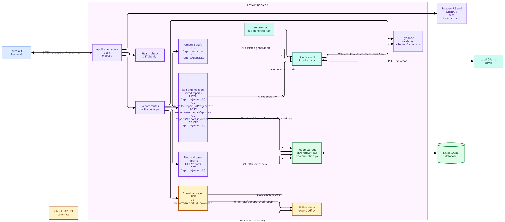

# FastAPI Backend

The FastAPI backend supports manual and AI-assisted DAP drafts, searchable
report history, review and approval, and PDF downloads. It saves source notes
and reports in SQLite and uses local Ollama for AI generation. Use synthetic
student data for development and testing.

## Diagram



## Local Setup

Run all commands in this guide from the **repository root**, which contains
`requirements.txt` and `pyproject.toml`.

Use Python 3.12. If you already have a working `.venv` for this project,
skip the creation command and use the environment you have.

**Windows (PowerShell)**

Use the creation command that matches your setup:

- If `python --version` shows Python 3.12, run `python -m venv .venv`.
- If `py -3.12 --version` shows Python 3.12, run `py -3.12 -m venv .venv`.
- If you still need Python 3.12, install the Python Install Manager, open a
  new PowerShell window, and run `py install 3.12`. Then run
  `py -3.12 -m venv .venv`. [Python Install Manager guide](https://docs.python.org/3/using/windows.html#python-install-manager)

Activate the environment with `.\.venv\Scripts\Activate.ps1`. If that
script is missing or PowerShell blocks it, use `.\.venv\Scripts\python.exe`
in place of `python` in the commands below.

**macOS and Linux (bash or zsh)**

```bash
python3.12 -m venv .venv
source .venv/bin/activate
```

Install the dependencies using the virtual environment's Python:

```bash
python -m pip install -r requirements.txt
```

## Start the Server

```shell
python -m uvicorn documentation_assistant.backend.main:app --app-dir src --host 127.0.0.1 --port 8000 --reload
```

The server listens locally on port 8000. The `--reload` option restarts the
development server after code changes.
Change `--port` if another application is using port 8000.

## Shut Down the Server

Press **Ctrl+C** in the terminal running Uvicorn and wait for the shell
prompt to return. Saved reports remain in SQLite and are available the next
time you start FastAPI.

## Available Endpoints

| Endpoint | Purpose |
| --- | --- |
| [GET /health](http://127.0.0.1:8000/health) | Confirms the backend is responding. |
| [GET /docs](http://127.0.0.1:8000/docs) | Interactive API documentation. |
| [GET /openapi.json](http://127.0.0.1:8000/openapi.json) | Machine-readable API schema. |
| `POST /reports/generate` | Generates and saves an unapproved DAP draft from synthetic notes. |
| `POST /reports/manual` | Opens a draft with blank DAP sections and optional source notes. |
| `GET /reports` | Lists and filters saved report summaries, newest saved first. |
| `GET /reports/{report_id}` | Retrieves a saved report, its source notes, and its review state. |
| `GET /reports/{report_id}/download` | Downloads the current saved draft or approved report as a PDF. |
| `PATCH /reports/{report_id}` | Saves corrected source notes, DAP sections, or report details on a draft. |
| `POST /reports/{report_id}/regenerate` | Saves corrected notes and new AI-generated DAP sections on the same draft. |
| `DELETE /reports/{report_id}?revision=1` | Permanently deletes a draft if the supplied revision is current. |
| `POST /reports/{report_id}/approve` | Approves the saved revision and makes it read-only. |
| `POST /reports/{report_id}/reopen` | Returns the approved revision to draft for corrections. |

The health endpoint returns:

```json
{"status": "ok"}
```

This checks API liveness and works independently of Ollama.

## Start a Draft

For manual writing, send optional notes and metadata to
`POST /reports/manual`. Use `{}` to start an empty report. The response contains
the saved notes and blank DAP sections. You can save a draft while sections are still blank and
approve it after all three contain text. You can create and review manual
drafts with Ollama stopped.

For AI-assisted writing, use `POST /reports/generate`. The API records the
draft source based on the endpoint used.

Start Ollama and run `ollama pull qwen3:8b` if the model is missing. The backend
uses Ollama on `127.0.0.1:11434`. To use a different installed model, set
`OLLAMA_MODEL` before starting the backend. [Local Ollama setup guide](../../../docs/local-llm-setup.md)

- PowerShell: `$env:OLLAMA_MODEL = "your-model-tag"`
- bash or zsh: `export OLLAMA_MODEL="your-model-tag"`

In `/docs`, open **POST /reports/generate**, select **Try it out**, and submit:

```json
{"notes": "Synthetic student practiced a breathing exercise and reported feeling calmer afterward."}
```

AI-assisted generation and regeneration require 1–4,000 characters of notes
after trimming surrounding whitespace. Manual draft notes are optional and
have the same maximum.

The response has a `report_id`, a `draft` status, and `data`, `assessment`, and
`plan` under `sections`. Use the ID in **GET /reports/{report_id}** to retrieve
the draft alongside its source notes, including after restarting the backend.
Retrieval works with Ollama stopped.

The API validates that all three generated sections contain text. The prompt
asks Ollama to use `Not documented.` when the source notes lack information for
a section. Review the draft against the original notes for accuracy and
completeness before approving it. Restart FastAPI after editing the prompt so
it loads the new instructions. [DAP prompt guide](llm/prompts/README.md)

SQLite creates `data/dap.db` on first use of draft storage when the
backend starts from the repository root. To use another location, set
`DAP_DB_PATH` before starting the backend.

Use `GET /reports` to find a saved draft without already knowing its ID. Each
summary contains `report_id`, `status`, and a UTC `created_at` timestamp.
Drafts saved before timestamps were introduced have `created_at: null`.
When generating a draft, you can include a `metadata` object with
`student_name`, `student_id`, `school`, `grade`, `date_of_service`, and
`social_worker_name`.
Use a string for grade and `YYYY-MM-DD` for dates.

Send `metadata.start_time` and `metadata.end_time` as local 24-hour times in
`HH:MM` format. If the end precedes the start, the API returns `422`. This
also applies to a partial edit or regeneration request that changes one time
and conflicts with the other saved time. The response calculates
`metadata.total_minutes` when both times form a valid range.

Filter the list with any combination of `student_name` and
`social_worker_name` (partial, case-insensitive matches),
`student_id`, `school`, `grade`, `date_from`, and `date_to`. The date range
is inclusive and uses date of service. Drafts with missing values remain in
the unfiltered list.

Use `status=draft` or `status=approved` to show one status. Omit `status`
to show both. Use `approved_by` to search the recorded approver's name by
partial, case-insensitive match.

## Review and Approve

Open the report by ID to get its current `revision`. To save changes, send
that revision with any changes to `notes`, `sections`, or `metadata` to
`PATCH /reports/{report_id}`. Omit `sections` to keep the saved DAP text.
Include all three DAP fields when replacing `sections`. Within `metadata`,
include only the fields to change. Use `null` to clear an optional detail.
The response contains the new revision and the source notes. The report stays
in draft status. When review is complete, send the revision you reviewed
and the reviewer's name to `POST /reports/{report_id}/approve`. Replace the
example revision with the current revision returned by the API.

```json
{"revision": 2, "approved_by": "Taylor Example"}
```

Approval records the supplied name and a UTC `approved_at` timestamp and
makes the report read-only. Approval returns `409` if any DAP section is
blank. Editing or approving an already approved report also returns `409`.
If the revision is stale, reload the report and review the current version
before retrying. Editing and approval work with Ollama stopped.

## Regenerate From Corrected Notes

Call `POST /reports/{report_id}/regenerate` with the current draft revision
and the corrected notes. Include optional metadata changes in the same request.

```json
{"revision": 2, "notes": "The student practiced paced breathing."}
```

A successful response returns the full draft with the same report ID, the
corrected notes, replacement DAP sections, and an incremented revision.
Ollama errors leave the saved draft intact. Keep the user's corrected notes
in the form so they can retry. A stale revision or an approved report returns
`409`. Reload the report before retrying a stale edit.

## Reopen an Approved Report

After confirmation, call `POST /reports/{report_id}/reopen` with the revision
shown on screen, such as `{"revision": 3}`. The response keeps the same report
ID and saved content, increases the revision, and sets the status to `draft`.
The approver name and approval timestamp are cleared. Review and approve the
report again after editing it. Reopening works with Ollama stopped.

An unknown report returns `404`. A report already in draft or a stale
revision returns `409`.

## Delete a Draft

After the user confirms deletion, call `DELETE /reports/{report_id}?revision=1`
with the revision shown on screen. A successful deletion permanently removes
the report and returns `204` with an empty body. An approved report or a stale
revision returns `409`. A missing report returns `404`. Deletion works with
Ollama stopped.

## Download a PDF

In `/docs`, open **GET /reports/{report_id}/download**, select **Try it out**,
and submit the UUID of a saved report. A successful response contains PDF
bytes with `Content-Type: application/pdf` and a filename in
`Content-Disposition`.

Drafts have a `-draft.pdf` filename suffix and **DRAFT** on every page.
Approved PDFs show the saved reviewer name and date. The export uses the
current saved report, so save any pending edits before downloading.
A missing report returns `404`. Downloading works with Ollama stopped.

## Tests

Run the unit and integration tests from the repository root:

```shell
python -m pytest tests/unit tests/integration -v
```

To test actual model output, start Ollama and make sure the configured model
is installed. The live tests are skipped by default. Set
`RUN_LIVE_OLLAMA=1` to enable them. The `-s` flag shows the generated DAP text
for review.

**Windows (PowerShell)**

```powershell
$env:RUN_LIVE_OLLAMA = "1"
python -m pytest tests/llm -v -s
Remove-Item Env:RUN_LIVE_OLLAMA
```

**macOS and Linux (bash or zsh)**

```bash
RUN_LIVE_OLLAMA=1 python -m pytest tests/llm -v -s
```
