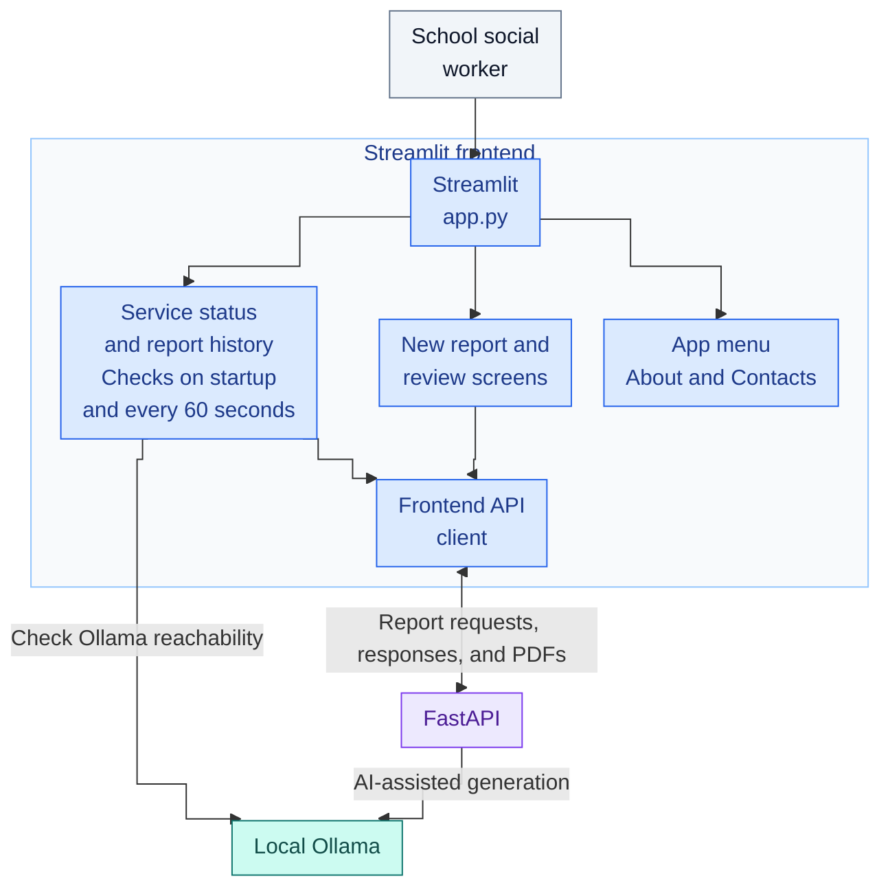

# Streamlit Frontend

The frontend lets school social workers create, review, and download Data,
Assessment, and Plan (DAP) reports. It sends report requests to FastAPI.
Use synthetic student data for development and testing.

## Diagram



## Local Setup

Run the commands from the repository root, where `requirements.txt` is located.
Use Python 3.12. If you already have a working `.venv` for the backend, skip
the creation command and activate that environment. [Backend setup guide](../backend/README.md#local-setup)

**Windows (PowerShell)**

Use the creation command that matches your setup:

- If `python --version` shows Python 3.12, run `python -m venv .venv`.
- If `py -3.12 --version` shows Python 3.12, run `py -3.12 -m venv .venv`.
- If you still need Python 3.12, install the Python Install Manager, open a
  new PowerShell window, and run `py install 3.12`. Then run
  `py -3.12 -m venv .venv`. [Python Install Manager guide](https://docs.python.org/3/using/windows.html#python-install-manager)

Activate the environment with `.\.venv\Scripts\Activate.ps1`. If that
script is missing or PowerShell blocks it, use `.\.venv\Scripts\python.exe`
in place of `python` in the commands below.

**macOS and Linux (bash or zsh)**

```bash
python3.12 -m venv .venv
source .venv/bin/activate
```

Install the dependencies with the virtual environment's Python:

```shell
python -m pip install -r requirements.txt
```

## Start the Servers

In the first terminal, start FastAPI:

```shell
python -m uvicorn documentation_assistant.backend.main:app --app-dir src --host 127.0.0.1 --port 8000 --reload
```

Open a second terminal at the repository root and activate the same environment.
Set `PYTHONPATH` so Streamlit can import the frontend modules from `src`.

**Windows (PowerShell)**

```powershell
$env:PYTHONPATH = (Resolve-Path src).Path
python -m streamlit run src/documentation_assistant/frontend/app.py
```

**macOS and Linux (bash or zsh)**

```bash
PYTHONPATH="$PWD/src" python -m streamlit run src/documentation_assistant/frontend/app.py
```

Open the **Local URL** printed by Streamlit, usually `http://localhost:8501`.
The frontend uses `http://127.0.0.1:8000` for FastAPI by default. If FastAPI runs
at a different address, set `DAP_API_URL` before launching Streamlit.

Start Ollama when you want to generate or regenerate an AI-assisted draft.
You can create and review manual drafts with FastAPI running and Ollama
stopped. [Local Ollama setup guide](../../../docs/local-llm-setup.md)

## Shut Down the Servers

Press **Ctrl+C** in the Streamlit terminal to stop the frontend. To stop
FastAPI, press **Ctrl+C** in its terminal. Saved reports remain in SQLite.

## Use the Frontend

1. Under **History Reports**, select **New report**. Enter synthetic session
   notes and any optional session details. The social worker fills in the risk
   and mandated reporting fields.
2. Select **Written by hand** to start with blank DAP sections or
   **AI-assisted draft** to generate sections from the notes. AI-assisted
   drafts require notes.
3. In the review screen, compare the source notes with the DAP sections.
   Select **Save draft** after editing. To approve the saved version, enter
   the approver's name and select **Approve saved draft**.
4. Select **Prepare PDF**, then **Download PDF**. The PDF uses the last
   saved version. You can export drafts and approved reports.

Use **Filter report** and **Open report** under **History Reports** to find a
saved report. To edit an approved report, select **Reopen as draft**.

### Service Status

Streamlit checks FastAPI and Ollama when the report page opens and every
60 seconds while the session is active. The timer refreshes only the status
panel. Click **Backend Status** or **AI Status** to check immediately.

If FastAPI is down, **Backend Status** turns red and the connection error
appears below the buttons. If report history couldn't load, start FastAPI
and click **Backend Status** to load it. **AI Status** checks whether Ollama
is reachable. AI-assisted drafting also needs the configured model installed.

### About and Contacts

Open the three-dot menu and select **About** for the project description.
Select **Report a bug** to open the team's **Contacts** page. Use
**Back to reports** to return to the report screens.

## Troubleshooting

| What you see | What to do |
| --- | --- |
| `ModuleNotFoundError: No module named 'documentation_assistant'` | Set `PYTHONPATH` to the repository's `src` folder and restart Streamlit. |
| `File does not exist` when launching Streamlit | Run the command from the repository root and keep the `src/` prefix in the script path. |
| Backend Status is red and a connection error appears below it | Start FastAPI, then click **Backend Status** to check again and load report history. |
| AI Status reports Ollama is unreachable | Start Ollama and click **AI Status** to check again. If generation reports that the model is unavailable, check that FastAPI's configured model is installed. |
| The app says the draft was saved but could not be opened | Click **Retry opening draft** in the same browser tab. The button uses the saved report ID. |
