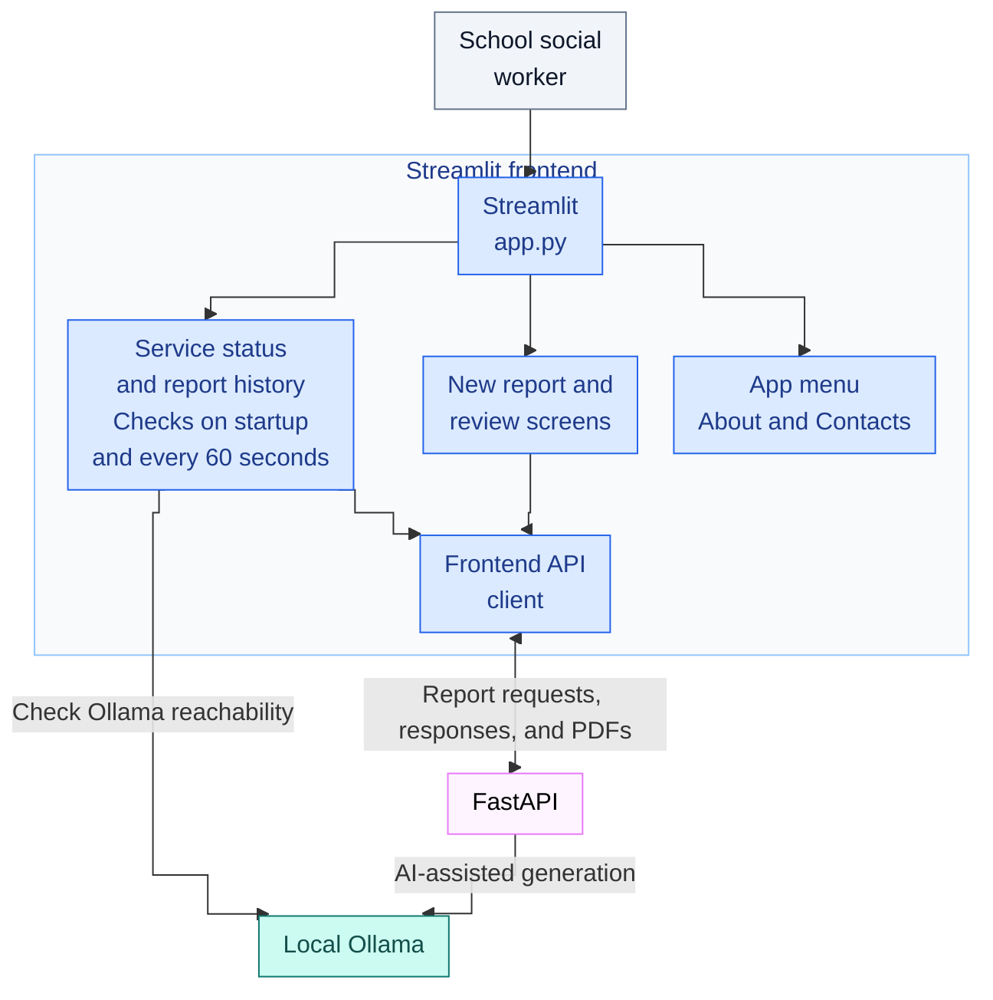
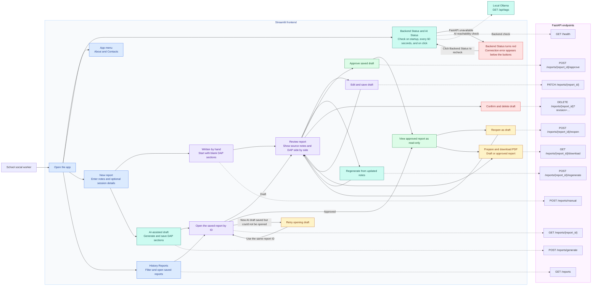

# Streamlit Frontend

The frontend lets school social workers create, review, and download Data,
Assessment, and Plan (DAP) reports. It sends report requests to FastAPI.

## Overview Diagram



## Detailed Diagram



## Local Setup

Run the commands from the repository root, where `requirements.txt` is located.
Use Python 3.12. If you already have a working `.venv` for the backend, skip
the creation command and activate that environment. [Backend setup guide](../backend/README.md#local-setup)

**Windows (PowerShell)**

Use the creation command that matches your setup:

- If `python --version` shows Python 3.12, run `python -m venv .venv`.
- If `py -3.12 --version` shows Python 3.12, run `py -3.12 -m venv .venv`.
- If you still need Python 3.12, install the Python Install Manager, open a
  new PowerShell window, and run `py install 3.12`. Then run
  `py -3.12 -m venv .venv`. [Python Install Manager guide](https://docs.python.org/3/using/windows.html#python-install-manager)
Activate the environment with `.\.venv\Scripts\Activate.ps1`. If that
script is missing or PowerShell blocks it, use `.\.venv\Scripts\python.exe`
in place of `python` in the commands below.

**macOS and Linux (bash or zsh)**

```bash
python3.12 -m venv .venv
source .venv/bin/activate
```

Install the dependencies with the virtual environment's Python:

```shell
python -m pip install -r requirements.txt
```

## Start the Servers

In the first terminal, start FastAPI:

```shell
python -m uvicorn documentation_assistant.backend.main:app --app-dir src --host 127.0.0.1 --port 8000 --reload
```

Open a second terminal at the repository root and activate the same environment.
Set `PYTHONPATH` so Streamlit can import the frontend modules from `src`.

**Windows (PowerShell)**

```powershell
$env:PYTHONPATH = (Resolve-Path src).Path
python -m streamlit run src/documentation_assistant/frontend/app.py
```

**macOS and Linux (bash or zsh)**

```bash
PYTHONPATH="$PWD/src" python -m streamlit run src/documentation_assistant/frontend/app.py
```

Open the **Local URL** printed by Streamlit, usually `http://localhost:8501`.
The frontend uses `http://127.0.0.1:8000` for FastAPI by default. If FastAPI runs
at a different address, set `DAP_API_URL` before launching Streamlit.

HTTP clients are reused across reruns within each browser session, with a
separate client for each environment-proxy policy. Requests to `localhost`
and loopback IPs such as `127.0.0.1` and `::1` bypass environment proxy settings.
Remote backends, including container service names, honor the environment's
proxy, `NO_PROXY`, and certificate settings. Local backend requests and Ollama
status checks can share a client because both bypass environment settings.
Streamlit closes the clients when it releases the session's cached resources.
Report responses and PDF contents are not cached by these clients.

Start Ollama when you want to generate or regenerate an AI-assisted draft.
You can create and review manual drafts with FastAPI running and Ollama
stopped. [Local Ollama setup guide](../../../docs/LOCAL-OLLAMA-SETUP.md)

## Shut Down the Servers

Press **Ctrl+C** in the Streamlit terminal to stop the frontend. To stop
FastAPI, press **Ctrl+C** in its terminal. Saved reports remain in SQLite.

## Use the Frontend

1. Under **History Reports**, select **New report**. Enter synthetic session
   notes and any optional session details. The social worker fills in the risk
   and mandated reporting fields.
2. Select **Written by hand** to start with blank DAP sections or
   **AI-assisted draft** to generate sections from the notes. AI-assisted
   drafts require notes.
3. In the review screen, compare the source notes with the DAP sections.
   Select **Save draft** after editing. To approve the saved version, enter
   the approver's name and select **Approve saved draft**.
4. Select **Prepare PDF**, then **Download PDF**. The PDF uses the last
   saved version. You can export drafts and approved reports.

Use **Filter report** and **Open report** under **History Reports** to find a
saved report. To edit an approved report, select **Reopen as draft**.
History shows 25 reports per page, newest first. Use **Previous** and **Next**
to browse matching reports. Applying or clearing filters returns to page one.

### Service Status

Streamlit checks FastAPI and Ollama when the report page opens and every
60 seconds while the session is active. The timer refreshes only the status
panel. Click **Backend Status** or **AI Status** to check immediately.
Other full-page reruns reuse each service's result for up to 60 seconds;
clicking a status button immediately rechecks that service.

If FastAPI is down, **Backend Status** turns red and the connection error
appears below the buttons. If report history couldn't load, start FastAPI
and click **Backend Status** to load it. **AI Status** checks whether Ollama
is reachable. AI-assisted drafting also needs the configured model installed.

### About and Contacts

Open the three-dot menu and select **About** for the project description.
Select **Report a bug** to open the team's **Contacts** page. Use
**Back to reports** to return to the report screens.

## Tests

From the repository root, use the Python 3.12 virtual environment created in
**Local Setup**. Install the test dependencies with
`python -m pip install -r requirements.txt`.

Run the frontend unit tests:

```shell
python -m pytest tests/unit -k frontend -v
```

The unit tests cover API response handling, Ollama status checks, report labels
and filters, date and time conversion, screen routing, session state, report
actions, and PDF download controls. They mock HTTP requests and Streamlit
controls to check each module independently.

Run the frontend integration tests:

```shell
python -m pytest tests/integration -k frontend -v
```

The integration tests use Streamlit's `AppTest` to enter values and click buttons.
Report workflow tests connect to FastAPI's test client and a temporary SQLite
database. Recovery tests simulate failed HTTP requests and backend reconnection.
A proxy regression test starts a temporary loopback HTTP server, and client
lifecycle tests check reuse, session isolation, and cleanup. Ollama status
responses are mocked, so both suites run without a model download.

| Workflow | What the integration tests verify |
| --- | --- |
| Draft recovery | Retry opens the saved report after a failed fetch without generating a duplicate. |
| Backend reconnection | A backend outage skips history loading, and a manual status check restores history after recovery. |
| Validation errors | Invalid session times display the backend explanation, retain pending edits, and leave the saved report unchanged. |
| Proxy handling and clients | Local requests work with a configured proxy; cached clients remain isolated by session and are closed on release. |
| History pagination | Previous/Next navigation shows the correct page; applying or clearing filters returns to page one. |
| Save and reopen | All three saved DAP sections persist after opening another report. |
| Approval and reopening | Unsaved edits block approval, approved fields become read-only, and confirmed reopening restores editing. |
| Concurrent edits | A stale save displays a conflict, preserves pending edits, and protects the newer saved revision. |
| Draft deletion | Confirmation is required, deletion refreshes history, and the interface returns to blank session notes. |
| Blank notes | AI generation requires notes, while handwritten drafts can start with blank notes. |
| Back to notes | Pending DAP and metadata edits carry into the notes screen and save to the same report. |
| Discard changes | Saved values are restored without writing pending changes to SQLite. |

Both suites run in the existing **Unit Tests** and **Integration Tests** CI jobs.
The installed-wheel validation also exercises handwritten draft creation, saving,
and PDF export on Windows, Ubuntu, and macOS.

## Troubleshooting

| What you see | What to do |
| --- | --- |
| `ModuleNotFoundError: No module named 'documentation_assistant'` | Set `PYTHONPATH` to the repository's `src` folder and restart Streamlit. |
| `File does not exist` when launching Streamlit | Run the command from the repository root and keep the `src/` prefix in the script path. |
| Backend Status is red and a connection error appears below it | Start FastAPI, then click **Backend Status** to check again and load report history. |
| AI Status reports Ollama is unreachable | Start Ollama and click **AI Status** to check again. If generation reports that the model is unavailable, check that FastAPI's configured model is installed. |
| The app says the draft was saved but could not be opened | Click **Retry opening draft** in the same browser tab. The button uses the saved report ID. |
| Saving displays a validation explanation | Correct the indicated values and retry. For session times, the end must be on or after the start on the same day. Rejected changes are not saved. |
